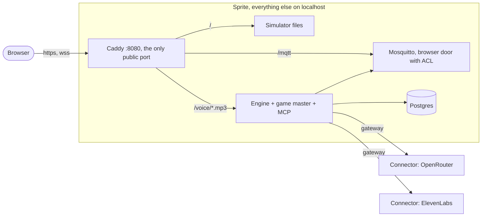

# Deploying to a Fly.io Sprite

One Sprite runs everything: the engine with the AI game master, Postgres, the MQTT broker and the simulator's
web build. Two Sprites Connectors hold the model and voice keys, so no API key is ever on the Sprite.



## What is public and what is not

| Path | Public | Why |
|---|---|---|
| `/` | yes | the simulator |
| `/mqtt` | yes, limited | a browser acts as the room's hardware; the broker's ACL lets it write only the room's sensor, start and player topics, and read only the room's topics |
| `/voice/<hash>.mp3` | yes | spoken lines; names are content hashes |
| `/rooms`, `/mcp`, `/safety` | no (404) | the engine API, the MCP server and the safety layer have no login, so they stay on localhost. Reach them with `sprite proxy 5201` |
| Postgres, MQTT over TCP | no | localhost only |

Spending is capped in `env`: games started from a browser per hour (`GAME_STARTS_PER_HOUR`) and characters of
speech per day (`VOICE_CHARACTERS_PER_DAY`). The ACL is generated from the room definition by `make-acl.py`,
so it always matches the room's real input topics.

## Steps

1. Install the CLI and log in.

   ```bash
   curl https://sprites.dev/install.sh | bash
   ```

   ```bash
   sprite login
   ```

2. Create the Sprite with a label the Connectors can match.

   ```bash
   sprite create the-core --label escaperoom --skip-console
   ```

3. Create two Connectors in the dashboard (Sprites → Connectors → Add connector), both as **custom API**
   connectors so the forwarded path is known, and both limited to the label `escaperoom` instead of "Allow all sprites":

   | Name | Base API URL | Auth method | Header |
   |---|---|---|---|
   | `openrouter-gm` | `https://openrouter.ai/api` | header | `Authorization: Bearer <OpenRouter key>` |
   | `elevenlabs-voice` | `https://api.elevenlabs.io` | custom header | `xi-api-key: <ElevenLabs key>` |

   Note each connector's gateway URL: `https://api.sprites.dev/v1/gateway/<provider>/<connection_id>`.

4. Build the bundle locally and send it over.

   ```bash
   deploy/build.sh
   ```

   ```bash
   sprite file push -s the-core deploy/bundle.tgz /home/sprite/bundle.tgz
   ```

   ```bash
   sprite exec -s the-core -- bash -c "cd /home/sprite && tar xzf bundle.tgz && bundle/deploy/setup.sh"
   ```

   The first run creates `/home/sprite/app/env` and stops. Fill in `PUBLIC_URL` (from `sprite info the-core`)
   and the two gateway URLs, then run the same command again. It installs Postgres, Mosquitto and Caddy,
   registers the services, loads the room and its brief, and prints the public checks.

5. Check the Connectors from inside the Sprite before opening it up (both should answer with JSON, not 401/403):

   ```bash
   sprite exec -s the-core -- bash -c '. /home/sprite/app/env; curl -s $GAMEMASTER_GATEWAY/v1/models | head -c 200; echo; curl -s $VOICE_GATEWAY/v1/models | head -c 200'
   ```

6. Make the URL public and open it.

   ```bash
   sprite url update -s the-core --auth public
   ```

To update later: run `deploy/build.sh`, push the bundle and run `setup.sh` again. Logs are in
`/.sprite/logs/services/{engine,web,mosquitto,postgres}.log`. Take a checkpoint before a demo:
`sprite checkpoint create --comment "before demo"`.

## Cost on the Free plan

The Free plan covers $5 of usage a month. A running Sprite is billed for CPU ($0.0385 per CPU-hour) and memory
($0.021875 per GB-hour); a paused one only for storage (about $0.02 per GB a month). A Sprite pauses after about
30 seconds without activity and wakes on the next request, so the demo costs money only while someone watches.
At roughly 0.2 CPU and 1 GB of memory that is about $0.03 an hour: around 150 hours of watched demo a month fit
in the Free plan. Model and voice calls are billed by OpenRouter and ElevenLabs, not by Fly; the two caps above
bound them.

## Not verified yet

These come from the Sprites documentation, not from a run on a real Sprite:

- WebSocket upgrades through the public `*.sprites.app` URL (the docs say "HTTP(S) only"). If `/mqtt` does not
  connect, the simulator still runs with its offline director, but the game master is then not in the loop.
- `sudo`/`apt` and `systemctl` on the Sprite image, and the CPU architecture (the bundle is built for x86_64).
- Whether the gateway overrides the placeholder `Authorization` header the Anthropic SDK sends.
- Whether local connections between the engine and the broker keep the Sprite awake. If they do, the Sprite
  never pauses and costs about $22 a month; stop the `engine` service between demos in that case.
- One game runs at a time: two viewers restart each other's game.
