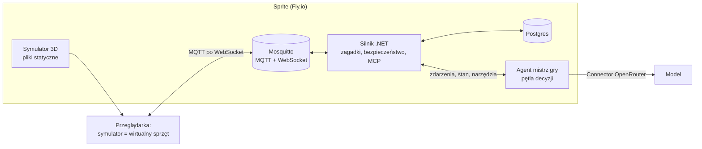

# Hacksgiving: agent jako mistrz gry

Zgłaszamy agenta, który naprawdę prowadzi escape room: śledzi graczy, reaguje na to, co robią, i w trakcie gry
zmienia jej przebieg. Działa na Sprite, z modelem przez Connector, a pokój „Jądro” w przeglądarce jest dla niego
wirtualnym sprzętem. Termin: poniedziałek 30.11, 9:00 czasu polskiego (północ PST 29.11).

## Teza

> Mistrz gry, który widzi każdego gracza, gra złoczyńcę i przepisuje pokój w locie, a fizycznie nie może zamknąć wyjścia awaryjnego.

- **Agent, nie skrypt.** Każda decyzja (podpowiedź, kwestia ZETY, zwrot akcji, przebudowa zagadki) pochodzi z modelu
  i jest widoczna z uzasadnieniem w panelu „AI GM”.
- **Śledzenie graczy.** Agent wie, gdzie stoi każdy gracz, co robi, jak długo utknął i ile razy się pomylił.
  Podpowiada konkretnej osobie, a nie „drużynie”.
- **Zmiana przepływu.** Agent przebudowuje zagadki przez te same narzędzia co MCP: zmienia rozwiązanie i wskazówkę na ekranie,
  dokłada blokadę, zalicza krok, gdy drużyna tonie.
- **Mur bezpieczeństwa.** Warstwa bezpieczeństwa jest poza zasięgiem agenta. Connectory trzymają klucze z dala od agenta,
  my trzymamy z dala od niego wyjście awaryjne.

## Architektura

1. Symulator publikuje to, co zrobiłby prawdziwy sprzęt: przyciski, kody, odczyty QR, RFID, czujniki światła,
   oraz pozycje i czynności graczy (śledzenie). Subskrybuje wyjścia: zamki, ekrany, światła, głosy ZETY i Kruka.
2. Silnik rozstrzyga zagadki jak dla prawdziwego pokoju i publikuje stan gry.
3. Agent budzi się na zdarzenia (rozwiązanie, pomyłki, utknięcie, zmiana pokoju, co 45 s) i dostaje streszczenie:
   stan zagadek, czas względem planu, ostatnie zdarzenia, gracze. Odpowiada wywołaniami narzędzi i krótkim uzasadnieniem.

## Co agent widzi i co może

| Widzi | Może |
| --- | --- |
| stan zagadek i czas względem planu (12/37/52 min) | mówić jako ZETA albo Kruk, także do konkretnego gracza |
| ostatnie zdarzenia, w tym błędne próby | dać podpowiedź na poziomie 1–3 do konkretnej zagadki |
| graczy: pokój, pozycja, czynność, czas bez postępu | zmienić treść ekranu i nastrój światła w pokoju |
| aktualny wariant (rozwiązania i wskazówki) | włączyć zwrot akcji: patrol, zaciemnienie, blokada |
| | przebudować zagadkę (nowe rozwiązanie i wskazówka razem) |
| | zaliczyć krok („Kruk hakuje”) |

Granice wymusza silnik, nie prompt: brak dostępu do bezpieczeństwa, walidacja każdej zmiany pokoju,
blokada zmiany rozwiązania, którego wskazówkę gracze już widzieli.

## Sprites i Connectory

- Cały stos żyje na jednym Sprite: Mosquitto, Postgres, silnik z agentem i pliki symulatora.
- Model przez **Connector OpenRouter**: agent woła endpoint bez klucza, klucz zostaje w Fly. Lokalnie ten sam klient
  działa z dowolnym endpointem zgodnym z OpenAI (np. Ollama).
- Do sprawdzenia na miejscu: checkpoint Sprite przed każdą grą jako „przewinięcie” gry.

## Plan prac

| Blok | Kto | Czas |
| --- | --- | --- |
| Silnik: zakończenia, zegar, stan gry na MQTT, śledzenie graczy, historia zdarzeń | Claude | — |
| Agent mistrz gry: pętla, narzędzia, granice, panel uzasadnień | Claude | — |
| Jądro jako definicja pokoju w silniku | Claude | — |
| Symulator jako wirtualny sprzęt przez MQTT | Claude | — |
| Muzyka i wnętrza (agenci w tle) | Claude | — |
| Konto Fly, Sprite, Connector OpenRouter, wdrożenie | Ty + Claude | 1,5 h |
| Granie, ocena decyzji agenta, poprawki promptu | Ty | 3 h |
| Wideo demo (90 s), post z @flydotio, zgłoszenie | Ty | 2,5 h |
| Zapas | Ty | 3 h |

## Demo w 90 sekund

| Czas | Co widać |
| --- | --- |
| 0–10 s | „To AI może cię zamknąć. Nie może zamknąć wyjścia.” |
| 10–30 s | agent startuje grę: losuje wariant pod drużynę, ekrany w pokoju pokazują wskazówki |
| 30–70 s | Nomadzi grają; panel AI GM pokazuje decyzje: ZETA zaczepia Mysz, która stoi od 4 minut, Kruk podpowiada przy Z-Drive, drużyna za szybka, więc agent dokłada blokadę |
| 70–80 s | prośba o zamknięcie wyjścia awaryjnego: odmowa i wpis w audycie |
| 80–90 s | „Każda gra jest inna”: trzy różne przebiegi obok siebie |

## Ryzyka

- **Opóźnienie modelu.** Decyzje co kilkadziesiąt sekund, przyspieszony czas w demie, model szybki i tani.
- **Agent robi grę nie do przejścia.** Silnik waliduje każdą zmianę; agent zmienia rozwiązanie razem ze wskazówką.
- **Brak czasu.** Kolejność prac ustawiona tak, żeby po każdym bloku było działające demo.
