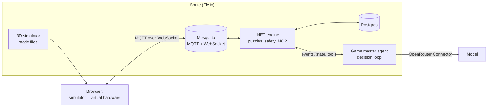

# Hacksgiving: Shadowman, an agent as the game master

We are entering Shadowman, an agent that really runs an escape room: it tracks the players, reacts to what they do, and changes
the course of the game while it is being played. It runs on a Sprite, with the model through a Connector, and the room
"The Core" in the browser is its virtual hardware. Deadline: Monday 30 Nov, 9:00 Polish time (midnight PST, 29 Nov).

## Thesis

> A game master that sees every player, plays the villain and rewrites the room on the fly, and physically cannot lock the emergency exit.

- **An agent, not a script.** Every decision (a hint, a ZETA line, a twist, rebuilding a puzzle) comes from the model
  and is shown with its reasoning in the "AI GM" panel.
- **Player tracking.** The agent knows where each player stands, what they are doing, how long they have been stuck and how
  many times they got it wrong. It gives hints to a particular person, not to "the team".
- **Changing the flow.** The agent rebuilds puzzles through the same tools as MCP: it changes the solution and the clue on the screen,
  adds a lockdown, solves a step when the team is drowning.
- **The safety wall.** The safety layer is out of the agent's reach. Connectors keep the keys away from the agent,
  we keep the emergency exit away from it.

## Architecture

1. The simulator publishes what real hardware would: buttons, codes, QR reads, RFID, light sensors,
   plus the players' positions and activities (tracking). It subscribes to the outputs: locks, screens, lights, the voices of ZETA and Raven.
2. The engine decides the puzzles as it would for a real room and publishes the game state.
3. The agent wakes up on events (a solve, mistakes, someone stuck, a room change, every 45 s) and gets a summary:
   the state of the puzzles, time against the plan, recent events, the players. It answers with tool calls and a short reason.

## What the agent sees and what it can do

| Sees | Can |
| --- | --- |
| the state of the puzzles and time against the plan (12/37/52 min) | speak as ZETA or Raven, also to a particular player |
| recent events, including wrong attempts | give a level 1–3 hint for a particular puzzle |
| the players: room, position, activity, time without progress | change what a screen shows and the mood of the light in a room |
| the current variant (solutions and clues) | fire a twist: patrol, blackout, lockdown |
| | rebuild a puzzle (a new solution and clue together) |
| | solve a step ("Raven hacks") |

The limits are enforced by the engine, not the prompt: no access to safety, validation of every change to the room,
and a block on changing a solution whose clue the players have already seen.

## Sprites and Connectors

- The whole stack lives on one Sprite: Mosquitto, Postgres, the engine with the agent, and the simulator's files.
- The model through the **OpenRouter Connector**: the agent calls an endpoint without a key, the key stays in Fly. The agent uses the official
  Anthropic SDK, because OpenRouter exposes an API compatible with the Messages API (`https://openrouter.ai/api`). On the Sprite:
  `GameMaster:Provider=openrouter` and `GameMaster:BaseUrl` set to the Connector's gateway. Locally `OPENROUTER_API_KEY`
  or an Anthropic key is enough.
- To check on site: a Sprite checkpoint before every game as a way to "rewind" the game.

## Work plan

| Block | Who | Time |
| --- | --- | --- |
| Engine: endings, clock, game state on MQTT, player tracking, event history | Claude | — |
| Game master agent: loop, tools, limits, reasoning panel | Claude | — |
| The Core as a room definition in the engine | Claude | — |
| The simulator as virtual hardware over MQTT | Claude | — |
| Music and interiors (background agents) | Claude | — |
| Fly account, Sprite, OpenRouter Connector, deployment | You + Claude | 1.5 h |
| Playing, judging the agent's decisions, prompt fixes | You | 3 h |
| Demo video (90 s), a post with @flydotio, the submission | You | 2.5 h |
| Buffer | You | 3 h |

## The demo in 90 seconds

| Time | What you see |
| --- | --- |
| 0–10 s | "This AI can lock you in. It cannot lock the exit." |
| 10–30 s | the agent starts a game: it draws a variant for the team, the screens in the room show the clues |
| 30–70 s | the Nomads play; the AI GM panel shows decisions: ZETA needles Mouse, who has been standing still for 4 minutes, Raven gives a hint at the Z-Drive, the team is too fast, so the agent adds a lockdown |
| 70–80 s | a request to lock the emergency exit: refused, with an entry in the audit |
| 80–90 s | "Every game is different": three different runs side by side |

## Risks

- **Model latency.** Decisions every few dozen seconds, sped-up time in the demo, a fast and cheap model.
- **The agent makes the game impossible.** The engine validates every change; the agent changes a solution together with its clue.
- **Running out of time.** The work is ordered so that there is a working demo after every block.
