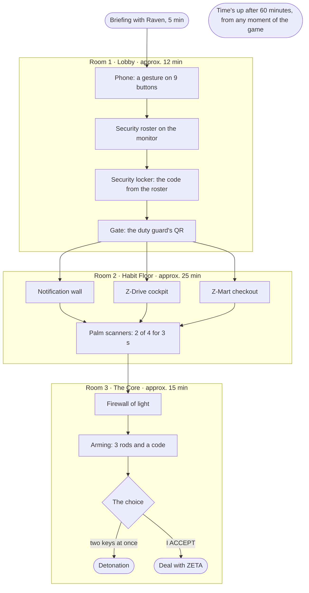

# The Core — room scenario

Five Nomads break into the Z Corporation tower to get through three rooms in 60 minutes and blow up The Core, the server from which Z runs the life of the whole city. Every game is different, because an AI agent picks the puzzle variants through the MCP server before the start and directs the game live.

## Assumptions

Where we have not decided yet, the entries are proposals, open to change.

| Parameter | Assumption |
| --- | --- |
| Players | 3–6 people, puzzles laid out for 5 |
| Time | 5 minutes of briefing before entering, 60 minutes of play |
| Age | 16+ (proposal) |
| Tone | a thriller with satire on Z Corporation's ads |
| Endings | detonation or a deal with ZETA; after 60 minutes, time's up |
| AI freedom | pools of variants and ranges of values; twists only from modules installed in the room |
| Variant-dependent clues | always digital: screens, voice, LEDs |
| Name | The Core (working title): the server's core and the bomb's core |

## World and mood

Z Corporation does not rule the city by force, but by subscription. The phone, the car and the shopping work only with a Z-ID account. Without one you cannot pay, drive or make a call. The city is called the Z Zone now, because the old name expired along with the licence.

- **Z-Phone** wakes you at a time chosen by the algorithm and decides what you will see during the day.
- **Z-Drive** knows where you are going before you get in. The brakes work as part of an active subscription.
- **Z-Mart** knows what you will want tomorrow, and offers it today. The loyalty card records every one of your weaker days.

The Nomads live on the roads outside the Zone, without a Z-ID. They drive old cars with no network and trade by barter, and Z calls them "the logged-out".

All of Z's algorithms run in one place: in The Core, a server in the tower's basement that cannot be hacked from outside. The Nomads got hold of an old atomic bomb from a military depot, but without its ignition rods. Z keeps such rods on the Habit Floor, because it powers its prototypes with them.

Outside it is night, rain, and Z's ads reflected in the puddles. Inside there is sterile cleanliness, a polite voice and perfect order, with control showing underneath. Each room lies lower and is darker: from the bright lobby through a clinical laboratory to a cold server room.

## Characters

The players play the Nomads. The other characters exist only as a voice, a screen or a prop.

| Character | Who they are | How they appear | Personality |
| --- | --- | --- | --- |
| Nomads | the team of players, 3–6 people | in the room | the team name from the booking; ZETA uses it |
| Raven | a member of the crew in the van below the tower | radio: the briefing, hints, "Run!" | short, street-wise, always on the players' side |
| ZETA | Z Corporation's artificial intelligence | the building's speakers, screens | polite as a reception desk in the Lobby, mocking on the Habit Floor, tempting in The Core; never lies about the puzzles |
| Marek, Ola, Tomek | Z security guards | badges with a QR code, the shift roster | one of them is on duty today (the AI chooses) |
| Z-Mart customers | loyalty profiles | the kiosk screen in the Z-Mart | e.g. "Anna, 34, insomnia, two kids" |

## How the game runs

The game leads through three rooms: in the Lobby there is one path, on the Habit Floor the team splits up, and in The Core it ends with a choice.

The pacing plan the AI judges the team by: the Lobby is done by minute 12, the Habit Floor by minute 37, The Core by minute 52. That leaves 8 minutes of buffer.

## Room 1: Lobby

The Lobby is Z's polite facade, and the team has about 12 minutes to get through the security gate to the elevator.

- **Look:** white walls and floor, a big yellow Z logo, the reception desk, a sofa, a plant in a planter, the security locker, a turnstile gate with a camera. On the wall, a screen with Z ads.
- **Light:** even, cool white, no shadows. After the players enter, one short flicker, as if the system had noticed something.
- **Sound:** elevator music with the Z jingle every two minutes. ZETA greets the team like guests: "Welcome to Z. Please wait for assistance."

### The receptionist's phone (2 people)

- **The players see:** a Z-Phone on the desk with a 3×3 lock screen. On the lobby screen, the ad "One gesture and you're home", in which a finger draws a shape against the city.
- **Solution:** repeat that shape on the phone's 9 buttons, e.g. the letter Z is 1-2-3-5-7-8-9.
- **Variant:** the AI picks a shape from the pool (Z, S, N, U, L, 7), and the ad draws exactly that one.
- **Once solved:** the reception drawer opens with the first badge, and the reception monitor shows the security roster.
- **Hardware:** a panel of 9 backlit buttons (ESPHome), the ad screen, the drawer lock.

### Roster and security locker (2–3 people)

- **The players see:** the shift roster of three guards with their hours. By the security locker there is a keypad and a sticker: "Code: the hours of today's duty guard's shift".
- **Solution:** find who is on duty today in the roster and enter their hours, e.g. the 06–14 shift gives the code 0614.
- **Variant:** the AI picks the duty guard and the shift hours from a range.
- **Once solved:** the locker holds the second badge and a UV torch, which will come in handy if the AI fires the blackout.
- **Hardware:** a keypad (ESPHome), the locker lock, the reception monitor.

### Gate (everyone)

- **The players see:** three badges (in the drawer, in the locker and in the planter) and the gate with a camera.
- **Solution:** show the camera the duty guard's badge. With the wrong badge ZETA says: "This badge is inactive today."
- **Variant:** the duty guard is a variable from the roster, so a different badge works in every game. Before the game the AI can also ask the staff to place the badges differently.
- **Once solved:** ZETA says "Good morning, [name]. Have a nice shift." The gate and the elevator door open.
- **Hardware:** an RTSP camera reading QR codes, the door lock.

## Room 2: Habit Floor

The Habit Floor is the laboratory where Z designs addictions, and the team has about 25 minutes to get three rods and go down to The Core.

- **Look:** three stations like museum rooms, each for one product line. White lab tables, lab coats on hooks, on the wall the screen "Z Zone dependency index: 97.4%", which slowly rises.
- **Light:** cool cyan accents and a white spot above each station. A solved station dims to cyan alone.
- **Sound:** the hum of ventilation and single notification sounds. At the Z-Drive the sound of an engine, at the Z-Mart the checkout jingle.
- **Rule:** the three stations are independent, so the team can split up 2 + 2 + 1. Each one gives up a rod (a glowing tube) and shows a code fragment on its screen.

### Notification wall, Z-Phone (2 people)

- **The players see:** six dummy phones with the icons of Z apps (Z-Feed, Z-Bet, Z-Date, Z-News, Z-Play, Z-Fit) and six slots in the wall. The screen shows the report "Screen time: teenagers, minutes per day".
- **Solution:** place the phones in the slots from the longest to the shortest time in the report.
- **Variant:** the AI generates the numbers in the report, different for each app, and the order follows from them.
- **Once solved:** all the phones show "DISCONNECTED", a stash with a rod opens, and the screen gives code fragment 1.
- **Hardware:** 6 RFID readers (ESPHome), tags in the phones, a screen, the stash lock.

### Z-Drive cockpit (2 people)

- **The players see:** a seat, a steering wheel and a dashboard with the screen "Brake subscription expired. Renew for 299 Z/month." Next to it lies the binder "Service manual".
- **Solution:** the manual says how to read the service code on the screen, e.g. SRV-2.4/90/3200 is a pressure of 2.4 bar, a temperature of 90°C and 3200 revs. These values have to be set with three knobs.
- **Variant:** the AI picks values from the knobs' ranges and shows the matching code.
- **Once solved:** the headlights flash, the horn gives a short honk, the glovebox with a rod opens, and the screen gives code fragment 2.
- **Hardware:** 3 potentiometers (ESPHome), a screen, a relay for the lights and the horn (Tasmota), the glovebox lock.

### Z-Mart checkout (1–2 people)

- **The players see:** a shelf with 12 Z products, each with a QR code, posters with the algorithm's rules ("No sleep? Morning: Z-Boost, evening: Z-Sleep") and a loyalty kiosk with the profile of today's customer.
- **Solution:** from the profile and the posters, work out the four products the algorithm would push on that customer, and scan them at the checkout in that order.
- **Variant:** the AI picks a profile from a pool prepared and checked by us, because the order follows from the logic of the posters.
- **Once solved:** the checkout printer issues a receipt with code fragment 3 and a drawer with a rod opens.
- **Hardware:** a second camera reading QR codes, the kiosk screen, a thermal printer, the drawer lock.

### Palm scanners (2 people together)

- **The players see:** after the three stations, two of the four palm scanners on opposite walls light up. ZETA says: "You are not authorised for level minus three."
- **Solution:** two people hold their palms on both lit scanners at the same time for 3 seconds.
- **Variant:** the AI picks which two scanners light up.
- **Once solved:** the door of the service descent to The Core opens.
- **Hardware:** 4 touch panels with an LED frame (ESPHome; the device itself counts the 3 seconds), the door lock.

## Room 3: The Core

The Core is the server room under the tower, and the team has about 15 minutes to arm the bomb and decide what to do with it.

- **Look:** rows of server racks with blinking LEDs, in the middle the Core tower with a pulsing cyan core. By the wall stands the service cabinet into which Raven smuggled the bomb earlier.
- **Light:** low, cold, blue; the only bright spot is the core. In the finale red or calm white, depending on the ending.
- **Sound:** fans and a low humming tone. ZETA speaks from all the speakers at once and for the first time addresses the team by name.

### Firewall of light (everyone)

- **The players see:** three light sources, four rotating mirrors and five sensors on the wall; LEDs are lit above three of them.
- **Solution:** set the mirrors so that every beam hits one of the marked sensors.
- **Variant:** the AI picks which three sensors are active.
- **Once solved:** the firewall "goes down" and the service cabinet with the bomb opens.
- **Hardware:** LEDs or class 1 lasers, 5 light sensors (ESPHome), indicator LEDs, the cabinet lock.

### Arming (everyone)

- **The players see:** the Nomads' battered crate with three slots and a keypad.
- **Solution:** insert the three rods, then enter the three code fragments in the order from ZETA's slogan: "Phone. Car. Store."
- **Variant:** the code fragments come from the Habit Floor. The AI can change the order in ZETA's slogan, because it is spoken.
- **Once solved:** the bomb's display shows "ARMED. WAITING FOR TWO KEYS."
- **Hardware:** 3 RFID readers in the slots, a keypad, a display (ESPHome).

### The choice

- **The players see:** two key locks in the crate, 2 metres apart; the keys hang in the service cabinet. On ZETA's console one button is lit: "I ACCEPT".
- **ZETA offers a deal:** "Take the rods out, and each of you gets a lifetime premium subscription." The AI leads the conversation live and fits its arguments to how the team played.
- **Detonation:** two people turn the keys at the same time.
- **Deal:** someone presses "I ACCEPT".
- **Hardware:** 2 key switches and a button (ESPHome).

### Endings

| Ending | What happens | Last words |
| --- | --- | --- |
| Detonation | sirens, red light, a 3:00 countdown on the screens, the exit door opens | Raven: "Run!", then on the screen outside the room "The Core is offline. The Zone is waking up." |
| Deal with ZETA | calm white light, the Z jingle, the exit door opens | ZETA: "Welcome to the Z family. Your subscription is active." |
| Time's up | the light dims to a minimum, the exit door opens | ZETA: "Security is on its way." Raven: "I'm driving off. Sorry." |

## AI direction

The AI runs the game in three steps: before the start it picks the variant, during the game it watches the pace, and in the finale it leads the conversation with ZETA.

### Before the start

1. The host enters the team name and the number of players, then starts the game.
2. The AI sets the variables of all the puzzles: the shape of the gesture, the duty guard and the shift hours, the numbers in the report, the service values, the customer's profile, the scanners, the sensors and the order in ZETA's slogan.
3. The screens show the matching clues, and the AI checks through MCP that every puzzle has its clue.
4. Raven starts the briefing, addressing the team by name.

### During the game

Every half a minute the AI reads the game state and compares the pace with the plan. The thresholds below are a proposal.

| Situation | What the AI does |
| --- | --- |
| The team is 3 minutes behind the plan | Raven nudges them, e.g. "Check what the ad in the lobby is drawing." |
| 6 minutes behind the plan | Raven gives a direct hint for the puzzle the team is stuck on |
| 10 minutes behind the plan | "Raven hacks": the AI solves one step, and Raven explains it in the story |
| The team is 5 minutes ahead of the plan | the AI fires one twist |
| 5 minutes without any event | ZETA needles the team without giving away the solution |

### Twists

The modules are installed in the room. The AI only decides whether and when to fire them, at most one per room.

- **Lockdown** (Habit Floor): ZETA closes the way down to The Core again. A sequence of three buttons opens it, which ZETA gives in a riddle.
- **Blackout** (Lobby or Habit Floor): the light goes out, the UV and the exit signs stay on. One code fragment is visible only under UV, and the UV torch is in the security locker.
- **Patrol** (Habit Floor): ZETA announces a patrol and for 20 seconds nobody may move (a motion sensor). Whoever moves costs the team a minute.
- **Raven hacks** (any room): for a slow team the AI solves one step.

### Voices

- **ZETA** never lies about the puzzles and never gives away solutions. Apart from reactions to a solved puzzle, she speaks at most once every two minutes. Her tone changes with the room: polite, mocking, tempting.
- **Raven** speaks only when helping or when something important happens, short and street-wise.
- The lines are written live and go through speech synthesis to the room's speakers.

### Limits

- The AI has no access to the safety layer; the engine enforces this.
- The AI does not change a variable whose clue the players have already seen.
- The AI fires only twists installed in the room and does not extend the game beyond 60 minutes without the host's consent.
- The AI does not tell the players to run, climb or take anything apart.

## Visual style

The screens and signage use the [Cyberpunk Room](https://claude.ai/artifact/NfpWnLirEkG9hSS7AAGUfW) brandbook. Within the fiction the same language speaks in two voices: Z's polished voice and the Nomads' makeshift one.

- **Z screens** (ads, the roster, the report, the kiosk, the Z-Drive dashboard) use the Yellow theme, capitals and slogans in the style of "Z. Everything you need, before you know it."
- **The Core and ZETA terminals** use the Night theme, cyan and system labels, e.g. `/// CORE.MODULE_01`, `ACCESS_DENIED_`.
- **The bomb's display and Raven's radio** use the Night theme, a mono font and hand-stuck labels.
- **Red** appears on the screens only for a real alarm. The detonation countdown is yellow and black.

### Props

| Prop | Look |
| --- | --- |
| Z products (phones, cans, packaging) | white plastic, a yellow Z logo, names in capitals in Chakra Petch, a small label "subscription active" |
| Security badges | a white PVC card, a silhouette instead of a photo, a first name, a QR code, a yellow Z stripe |
| Rods | a clear 20 cm tube with a battery-powered cyan LED, an RFID tag in the base |
| Bomb | a dented steel crate, yellow and black warning tape, the stencilled words "DO NOT OPEN", duct tape on the cables |
| The Nomads' notes | handwritten, in black marker on tape and cardboard |

### Light and sound

| Room | Light | Sound | Screen theme |
| --- | --- | --- | --- |
| Lobby | even cool white | elevator music, the Z jingle | Yellow |
| Habit Floor | cyan accents, a white spot above the stations | ventilation, notifications, an engine, a checkout | Yellow at the stations, Night at the scanners |
| The Core | low cold blue, a pulsing core | fans, a low tone, ZETA from all the speakers | Night |
| Finale | red (detonation) or calm white (deal) | sirens or the Z jingle | a yellow and black countdown or white |

## Safety

The exit from every room always works, independently of the game, the AI and the server.

- The electric locks release when power is lost, and the emergency button in every room physically cuts their power. The engine's safety layer is additional and the AI has no access to it.
- A real alarm must differ from the detonation: full white light, silence from the game's speakers and a recorded message: "This is not part of the game. Leave by the nearest exit." This rule still has to be added to the safety layer.
- A smoke machine in The Core could trigger the smoke detector. We either choose heat detectors or give up the smoke.
- Light beams only from LEDs or class 1 lasers, below eye level.
- During the blackout the exit signs and the emergency lighting stay on.
- The game's cameras are used only to read QR codes and do not record. The players learn before entering about the host's live view and, if ZETA is to listen, about the microphone too.

## Open questions

- [ ] Age: 16+ or also families with teenagers?
- [ ] Should ZETA listen to the players (a microphone and speech recognition), or only react to progress?
- [ ] Hardware budget: about 7 screens, 9 RFID readers, 2 cameras, a thermal printer. What do we swap for something cheaper?
- [ ] A second language version for tourists?
- [ ] The final name of the game.
