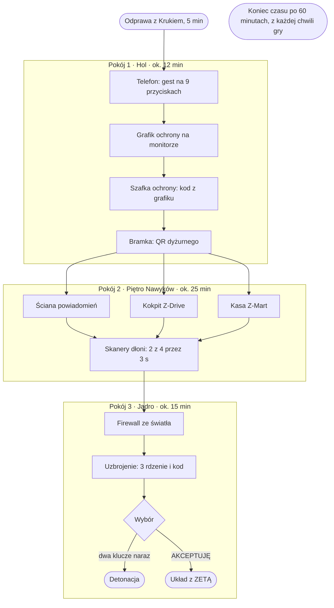

# Jądro — scenariusz pokoju

Pięcioro Nomadów wdziera się do wieży Korporacji Z, żeby w 60 minut przejść trzy pokoje i wysadzić Jądro, serwer, z którego Z steruje życiem całego miasta. Każda gra jest inna, bo agent AI przez serwer MCP dobiera warianty zagadek przed startem i reżyseruje grę na żywo.

## Założenia

Tam, gdzie jeszcze nie zdecydowaliśmy, wpisane są propozycje do zmiany.

| Parametr | Założenie |
| --- | --- |
| Gracze | 3–6 osób, zagadki ułożone pod 5 |
| Czas | 5 minut odprawy przed wejściem, 60 minut gry |
| Wiek | 16+ (propozycja) |
| Ton | thriller z satyrą na reklamy Korporacji Z |
| Zakończenia | detonacja albo układ z ZETĄ; po 60 minutach koniec czasu |
| Swoboda AI | pule wariantów i zakresy wartości; zwroty akcji tylko z modułów zamontowanych w pokoju |
| Wskazówki zależne od wariantu | zawsze cyfrowe: ekrany, głos, diody |
| Nazwa | Jądro (roboczo): jądro serwera i jądro ładunku |

## Świat i klimat

Korporacja Z nie rządzi miastem siłą, tylko abonamentem. Telefon, auto i zakupy działają wyłącznie z kontem Z-ID. Bez niego nie da się zapłacić, pojechać ani zadzwonić. Miasto nazywa się dziś Strefa Z, bo stara nazwa wygasła razem z licencją.

- **Z-Phone** budzi cię o porze wybranej przez algorytm i decyduje, co zobaczysz w ciągu dnia.
- **Z-Drive** wie, dokąd jedziesz, zanim wsiądziesz. Hamulce działają w ramach aktywnej subskrypcji.
- **Z-Mart** wie, czego zechcesz jutro, i podsuwa to dziś. Karta lojalnościowa zapisuje każdy twój słabszy dzień.

Nomadzi żyją na drogach poza Strefą, bez Z-ID. Jeżdżą starymi autami bez sieci i handlują wymianą, a Z nazywa ich „niezalogowanymi”.

Wszystkie algorytmy Z działają w jednym miejscu: w Jądrze, serwerze w podziemiach wieży, którego nie da się zhakować z zewnątrz. Nomadzi zdobyli z wojskowego magazynu stary ładunek atomowy, ale bez rdzeni zapłonowych. Takie rdzenie Z trzyma na Piętrze Nawyków, bo zasila nimi swoje prototypy.

Na zewnątrz jest noc, deszcz i reklamy Z odbite w kałużach. W środku panuje sterylna czystość, uprzejmy głos i idealny porządek, pod którymi widać kontrolę. Każdy pokój leży niżej i jest ciemniejszy: od jasnego holu przez kliniczne laboratorium do zimnej serwerowni.

## Postacie

Gracze grają Nomadów. Reszta postaci istnieje tylko jako głos, ekran albo rekwizyt.

| Postać | Kim jest | Jak się pojawia | Charakter |
| --- | --- | --- | --- |
| Nomadzi | drużyna graczy, 3–6 osób | w pokoju | nazwa drużyny z rezerwacji; ZETA jej używa |
| Kruk | osoba z ekipy w aucie pod wieżą | radio: odprawa, podpowiedzi, „Wiejcie!” | krótko, po ulicznemu, zawsze po stronie graczy |
| ZETA | sztuczna inteligencja Korporacji Z | głośniki budynku, ekrany | w holu uprzejma jak recepcja, na piętrze kpiąca, w Jądrze kusząca; nigdy nie kłamie o zagadkach |
| Marek, Ola, Tomek | ochroniarze Z | identyfikatory z QR, grafik zmian | jedno z nich ma dziś dyżur (wybiera AI) |
| Klientki i klienci Z-Martu | profile lojalnościowe | ekran kiosku w Z-Marcie | np. „Anna, 34 lata, bezsenność, dwoje dzieci” |

## Przebieg gry

Gra prowadzi przez trzy pokoje: w holu ścieżka jest jedna, na Piętrze Nawyków drużyna się rozdziela, a w Jądrze kończy się wyborem.

Plan tempa, według którego AI ocenia drużynę: Hol kończy się do 12. minuty, Piętro Nawyków do 37., Jądro do 52. Zostaje 8 minut zapasu.

## Pokój 1: Hol

Hol to uprzejma fasada Z, a drużyna ma około 12 minut, żeby przejść bramkę ochrony do windy.

- **Wygląd:** białe ściany i podłoga, duże żółte logo Z, lada recepcji, kanapa, roślina w donicy, szafka ochrony, bramka obrotowa z kamerą. Na ścianie ekran z reklamami Z.
- **Światło:** równa, chłodna biel, bez cieni. Po wejściu graczy jedno krótkie mrugnięcie, jakby system coś zauważył.
- **Dźwięk:** windowa muzyczka z dżinglem Z co dwie minuty. ZETA wita drużynę jak gości: „Witamy w Z. Proszę zaczekać na asystę.”

### Telefon recepcjonistki (2 osoby)

- **Gracze widzą:** na ladzie Z-Phone z ekranem blokady 3×3. Na ekranie holu reklama „Jeden gest i jesteś w domu”, w której palec rysuje kształt na tle miasta.
- **Rozwiązanie:** powtórzyć ten kształt na 9 przyciskach telefonu, np. litera Z to 1-2-3-5-7-8-9.
- **Wariant:** AI wybiera kształt z puli (Z, S, N, U, L, 7), a reklama rysuje właśnie ten.
- **Po rozwiązaniu:** otwiera się szuflada recepcji z pierwszym identyfikatorem, a monitor recepcji pokazuje grafik ochrony.
- **Sprzęt:** panel 9 podświetlanych przycisków (ESPHome), ekran reklamy, zamek szuflady.

### Grafik i szafka ochrony (2–3 osoby)

- **Gracze widzą:** grafik zmian trzech ochroniarzy z godzinami. Przy szafce ochrony jest klawiatura i naklejka „Kod: godziny dzisiejszej zmiany dyżurnego”.
- **Rozwiązanie:** znaleźć dzisiejszy dyżur w grafiku i wpisać jego godziny, np. zmiana 06–14 daje kod 0614.
- **Wariant:** AI wybiera dyżurnego i godziny zmian z zakresu.
- **Po rozwiązaniu:** w szafce leży drugi identyfikator i latarka UV, która przyda się, jeśli AI włączy zaciemnienie.
- **Sprzęt:** klawiatura (ESPHome), zamek szafki, monitor recepcji.

### Bramka (wszyscy)

- **Gracze widzą:** trzy identyfikatory (w szufladzie, w szafce i w donicy z rośliną) oraz bramkę z kamerą.
- **Rozwiązanie:** pokazać kamerze identyfikator dyżurnego. Przy złym identyfikatorze ZETA mówi: „Ten identyfikator jest dziś nieaktywny.”
- **Wariant:** dyżurny jest zmienną z grafiku, więc w każdej grze działa inny identyfikator. Przed grą AI może też zlecić obsłudze inne rozłożenie identyfikatorów.
- **Po rozwiązaniu:** ZETA mówi „Dzień dobry, [imię]. Miłej zmiany.” Bramka i drzwi windy się otwierają.
- **Sprzęt:** kamera RTSP z odczytem QR, zamek drzwi.

## Pokój 2: Piętro Nawyków

Piętro Nawyków to laboratorium, w którym Z projektuje uzależnienia, a drużyna ma około 25 minut, żeby zdobyć trzy rdzenie i zejść do Jądra.

- **Wygląd:** trzy stanowiska jak sale muzeum, każde dla jednej linii produktów. Białe stoły laboratoryjne, fartuchy na wieszakach, na ścianie ekran „Wskaźnik zależności Strefy Z: 97,4%”, który powoli rośnie.
- **Światło:** chłodne cyjanowe akcenty i punktowa biel nad każdym stanowiskiem. Rozwiązane stanowisko gaśnie do samego cyjanu.
- **Dźwięk:** szum wentylacji i pojedyncze dźwięki powiadomień. Przy Z-Drive odgłos silnika, przy Z-Marcie dżingiel kasy.
- **Zasada:** trzy stanowiska są niezależne, więc drużyna może się rozdzielić 2 + 2 + 1. Każde oddaje rdzeń (świecący pręt) i pokazuje fragment kodu na ekranie.

### Ściana powiadomień, Z-Phone (2 osoby)

- **Gracze widzą:** sześć atrap telefonów z ikonami aplikacji Z (Z-Feed, Z-Bet, Z-Date, Z-News, Z-Play, Z-Fit) i sześć gniazd w ścianie. Ekran pokazuje raport „Czas ekranowy: nastolatki, minuty dziennie”.
- **Rozwiązanie:** ułożyć telefony w gniazdach od najdłuższego do najkrótszego czasu z raportu.
- **Wariant:** AI generuje liczby w raporcie, różne dla każdej aplikacji, a z nich wynika kolejność.
- **Po rozwiązaniu:** wszystkie telefony pokazują „ODŁĄCZONO”, otwiera się skrytka z rdzeniem, a ekran podaje fragment kodu 1.
- **Sprzęt:** 6 czytników RFID (ESPHome), tagi w telefonach, ekran, zamek skrytki.

### Kokpit Z-Drive (2 osoby)

- **Gracze widzą:** fotel, kierownicę i deskę rozdzielczą z ekranem „Subskrypcja hamulców wygasła. Przedłuż za 299 Z/mies.” Obok leży segregator „Instrukcja serwisowa”.
- **Rozwiązanie:** instrukcja mówi, jak czytać kod serwisowy z ekranu, np. SRV-2.4/90/3200 to ciśnienie 2,4 bar, temperatura 90°C i 3200 obrotów. Te wartości trzeba ustawić trzema pokrętłami.
- **Wariant:** AI wybiera wartości z zakresów pokręteł i pokazuje pasujący kod.
- **Po rozwiązaniu:** mrugają reflektory, krótko trąbi klakson, otwiera się schowek z rdzeniem, a ekran podaje fragment kodu 2.
- **Sprzęt:** 3 potencjometry (ESPHome), ekran, przekaźnik świateł i klaksonu (Tasmota), zamek schowka.

### Kasa Z-Mart (1–2 osoby)

- **Gracze widzą:** regał z 12 produktami Z, każdy z kodem QR, plakaty z regułami algorytmu („Nie śpisz? Rano Z-Boost, wieczorem Z-Sen”) i kiosk lojalnościowy z profilem dzisiejszej klientki.
- **Rozwiązanie:** z profilu i plakatów wywnioskować cztery produkty, które algorytm by jej wcisnął, i zeskanować je przy kasie w tej kolejności.
- **Wariant:** AI wybiera profil z puli przygotowanej i sprawdzonej przez nas, bo kolejność wynika z logiki plakatów.
- **Po rozwiązaniu:** drukarka kasy wydaje paragon z fragmentem kodu 3 i otwiera się szuflada z rdzeniem.
- **Sprzęt:** druga kamera z odczytem QR, ekran kiosku, drukarka termiczna, zamek szuflady.

### Skanery dłoni (2 osoby razem)

- **Gracze widzą:** po trzech stanowiskach zapalają się dwa z czterech skanerów dłoni na przeciwnych ścianach. ZETA mówi: „Nie macie uprawnień do poziomu minus trzy.”
- **Rozwiązanie:** dwie osoby trzymają dłonie na obu zapalonych skanerach jednocześnie przez 3 sekundy.
- **Wariant:** AI wybiera, które dwa skanery się zapalą.
- **Po rozwiązaniu:** otwierają się drzwi zejścia serwisowego do Jądra.
- **Sprzęt:** 4 panele dotykowe z ramką LED (ESPHome; 3 sekundy liczy samo urządzenie), zamek drzwi.

## Pokój 3: Jądro

Jądro to serwerownia pod wieżą, a drużyna ma około 15 minut, żeby uzbroić ładunek i zdecydować, co z nim zrobić.

- **Wygląd:** rzędy szaf serwerowych z mrugającymi diodami, w środku wieża Jądra z pulsującym cyjanowym rdzeniem. Przy ścianie stoi szafa serwisowa, do której Kruk wcześniej przemycił ładunek.
- **Światło:** niskie, zimne, niebieskie; jedyne jasne miejsce to rdzeń. W finale czerwień albo spokojna biel, zależnie od zakończenia.
- **Dźwięk:** wentylatory i niski buczący ton. ZETA mówi ze wszystkich głośników naraz i pierwszy raz zwraca się do drużyny po nazwie.

### Firewall ze światła (wszyscy)

- **Gracze widzą:** trzy źródła światła, cztery obrotowe lustra i pięć czujników na ścianie; nad trzema świecą diody.
- **Rozwiązanie:** ustawić lustra tak, żeby każda wiązka trafiła w jeden z oznaczonych czujników.
- **Wariant:** AI wybiera, które trzy czujniki są aktywne.
- **Po rozwiązaniu:** firewall „pada” i otwiera się szafa serwisowa z ładunkiem.
- **Sprzęt:** diody albo lasery klasy 1, 5 czujników światła (ESPHome), diody wskaźników, zamek szafy.

### Uzbrojenie (wszyscy)

- **Gracze widzą:** odrapaną skrzynię Nomadów z trzema gniazdami i klawiaturą.
- **Rozwiązanie:** włożyć trzy rdzenie, potem wpisać trzy fragmenty kodu w kolejności z hasła ZETY: „Telefon. Auto. Sklep.”
- **Wariant:** fragmenty kodu pochodzą z Piętra Nawyków. AI może zmienić kolejność w haśle ZETY, bo jest mówione.
- **Po rozwiązaniu:** wyświetlacz ładunku pokazuje „UZBROJONY. CZEKAM NA DWA KLUCZE.”
- **Sprzęt:** 3 czytniki RFID w gniazdach, klawiatura, wyświetlacz (ESPHome).

### Wybór

- **Gracze widzą:** w skrzyni dwa zamki na klucze, oddalone o 2 metry; klucze wiszą w szafie serwisowej. Na konsoli ZETY świeci jeden przycisk „AKCEPTUJĘ”.
- **ZETA proponuje układ:** „Wyjmijcie rdzenie, a każdy z was dostanie dożywotni abonament premium.” Rozmowę prowadzi AI na żywo i dopasowuje argumenty do tego, jak drużyna grała.
- **Detonacja:** dwie osoby przekręcają klucze jednocześnie.
- **Układ:** ktoś naciska „AKCEPTUJĘ”.
- **Sprzęt:** 2 stacyjki na klucz i przycisk (ESPHome).

### Zakończenia

| Zakończenie | Co się dzieje | Ostatnie słowa |
| --- | --- | --- |
| Detonacja | syreny, czerwone światło, na ekranach odliczanie 3:00, drzwi wyjściowe się otwierają | Kruk: „Wiejcie!”, potem na ekranie przed pokojem „Jądro offline. Strefa się budzi.” |
| Układ z ZETĄ | spokojne białe światło, dżingiel Z, drzwi wyjściowe się otwierają | ZETA: „Witamy w rodzinie Z. Wasz abonament jest aktywny.” |
| Koniec czasu | światło gaśnie do minimum, drzwi wyjściowe się otwierają | ZETA: „Ochrona jest w drodze.” Kruk: „Odjeżdżam. Przykro mi.” |

## Reżyseria AI

AI prowadzi grę w trzech krokach: przed startem dobiera wariant, w trakcie pilnuje tempa, a w finale prowadzi rozmowę z ZETĄ.

### Przed startem

1. Prowadzący wpisuje nazwę drużyny i liczbę graczy, potem uruchamia grę.
2. AI ustawia zmienne wszystkich zagadek: kształt gestu, dyżurnego i godziny zmian, liczby w raporcie, wartości serwisowe, profil klientki, skanery, czujniki i kolejność w haśle ZETY.
3. Ekrany pokazują pasujące wskazówki, a AI sprawdza przez MCP, że każda zagadka ma swoją wskazówkę.
4. Kruk zaczyna odprawę, zwracając się do drużyny po nazwie.

### W trakcie gry

AI co pół minuty czyta stan gry i porównuje tempo z planem. Progi poniżej to propozycja.

| Sytuacja | Co robi AI |
| --- | --- |
| Drużyna 3 minuty za planem | Kruk naprowadza, np. „Sprawdźcie, co rysuje reklama w holu.” |
| 6 minut za planem | Kruk daje wprost wskazówkę do zagadki, na której drużyna stoi |
| 10 minut za planem | „Kruk hakuje”: AI zalicza jeden krok, a Kruk tłumaczy to w fabule |
| Drużyna 5 minut przed planem | AI włącza jeden zwrot akcji |
| 5 minut bez żadnego zdarzenia | ZETA zaczepia drużynę, nie zdradzając rozwiązania |

### Zwroty akcji

Moduły są zamontowane w pokoju. AI decyduje tylko, czy i kiedy je włączyć, najwyżej jeden na pokój.

- **Blokada** (Piętro Nawyków): ZETA ponownie zamyka zejście do Jądra. Otwiera je sekwencja trzech przycisków, którą ZETA podaje w zagadce słownej.
- **Zaciemnienie** (Hol lub Piętro Nawyków): gaśnie światło, zostaje UV oraz oznaczenia wyjść. Jeden fragment kodu widać tylko w UV, a latarka UV leży w szafce ochrony.
- **Patrol** (Piętro Nawyków): ZETA ogłasza patrol i przez 20 sekund nikt nie może się ruszyć (czujnik ruchu). Kto się ruszy, zabiera drużynie minutę.
- **Kruk hakuje** (każdy pokój): dla wolnej drużyny AI zalicza jeden krok.

### Głosy

- **ZETA** nigdy nie kłamie o zagadkach i nie zdradza rozwiązań. Poza reakcjami na rozwiązanie zagadki mówi najwyżej raz na dwie minuty. Ton zmienia się z pokojem: uprzejma, kpiąca, kusząca.
- **Kruk** mówi tylko wtedy, gdy pomaga albo dzieje się coś ważnego, krótko i po ulicznemu.
- Kwestie powstają na żywo i idą syntezą mowy na głośniki pokoju.

### Granice

- AI nie ma dostępu do warstwy bezpieczeństwa; silnik to wymusza.
- AI nie zmienia zmiennej, której wskazówkę gracze już widzieli.
- AI włącza tylko zwroty akcji zamontowane w pokoju i nie wydłuża gry ponad 60 minut bez zgody prowadzącego.
- AI nie każe graczom biegać, wspinać się ani niczego rozkręcać.

## Stylistyka

Ekrany i oznaczenia korzystają z brandbooka [Pokój cyberpunk](https://claude.ai/artifact/NfpWnLirEkG9hSS7AAGUfW). W fikcji ten sam język mówi dwoma głosami: dopracowanym głosem Z i prowizorycznym głosem Nomadów.

- **Ekrany Z** (reklamy, grafik, raport, kiosk, deska Z-Drive) mają motyw Żółty, wersaliki i hasła w stylu „Z. Wszystko, czego potrzebujesz, zanim o tym wiesz.”
- **Terminale Jądra i ZETY** mają motyw Noc, cyjan i etykiety systemowe, np. `/// CORE.MODULE_01`, `ACCESS_DENIED_`.
- **Wyświetlacz ładunku i radio Kruka** mają motyw Noc, czcionkę mono i ręcznie doklejone opisy.
- **Czerwień** pojawia się na ekranach tylko przy prawdziwym alarmie. Odliczanie detonacji jest żółto-czarne.

### Rekwizyty

| Rekwizyt | Wygląd |
| --- | --- |
| Produkty Z (telefony, puszki, opakowania) | biały plastik, żółte logo Z, nazwy wersalikami w Chakra Petch, mała etykieta „abonament aktywny” |
| Identyfikatory ochrony | biała karta PVC, sylwetka zamiast zdjęcia, imię, kod QR, żółty pasek Z |
| Rdzenie | przezroczysta rura 20 cm z cyjanową diodą na baterię, tag RFID w podstawie |
| Ładunek | wgnieciona stalowa skrzynia, żółto-czarna taśma ostrzegawcza, szablonowy napis „NIE OTWIERAĆ”, taśma klejąca na kablach |
| Notatki Nomadów | odręcznie, czarnym markerem na taśmie i kartonie |

### Światło i dźwięk

| Pokój | Światło | Dźwięk | Motyw ekranów |
| --- | --- | --- | --- |
| Hol | równa chłodna biel | windowa muzyczka, dżingiel Z | Żółty |
| Piętro Nawyków | cyjanowe akcenty, punktowa biel nad stanowiskami | wentylacja, powiadomienia, silnik, kasa | Żółty na stanowiskach, Noc przy skanerach |
| Jądro | niskie zimne niebieskie, pulsujący rdzeń | wentylatory, niski ton, ZETA ze wszystkich głośników | Noc |
| Finał | czerwień (detonacja) albo spokojna biel (układ) | syreny albo dżingiel Z | żółto-czarne odliczanie albo biel |

## Bezpieczeństwo

Wyjście z każdego pokoju działa zawsze, niezależnie od gry, AI i serwera.

- Elektrozamki puszczają po zaniku zasilania, a przycisk awaryjny w każdym pokoju fizycznie odcina im prąd. Warstwa bezpieczeństwa silnika jest dodatkowa i AI nie ma do niej dostępu.
- Prawdziwy alarm musi się różnić od detonacji: pełne białe światło, cisza w głośnikach gry i nagrany komunikat „To nie jest część gry. Wyjdźcie najbliższym wyjściem.” Tę regułę trzeba dopisać do warstwy bezpieczeństwa.
- Wytwornica dymu w Jądrze może uruchomić czujnik dymu. Wybieramy czujniki temperatury albo rezygnujemy z dymu.
- Wiązki światła tylko z diod albo laserów klasy 1, poniżej linii oczu.
- Przy zaciemnieniu oznaczenia wyjść i oświetlenie awaryjne świecą dalej.
- Kamery gry służą tylko do odczytu QR i nie nagrywają. O podglądzie dla prowadzącego, a jeśli ZETA ma słuchać, także o mikrofonie, gracze dowiadują się przed wejściem.

## Otwarte pytania

- [ ] Wiek: 16+ czy też rodziny z nastolatkami?
- [ ] Czy ZETA ma słuchać graczy (mikrofon i rozpoznawanie mowy), czy tylko reagować na postęp?
- [ ] Budżet sprzętu: około 7 ekranów, 9 czytników RFID, 2 kamery, drukarka termiczna. Co zamieniamy na tańsze?
- [ ] Wersja angielska dla turystów?
- [ ] Ostateczna nazwa gry.
