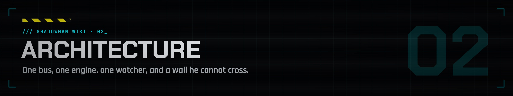
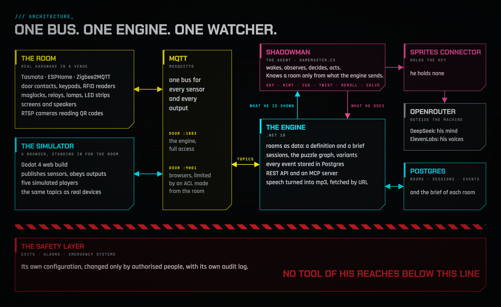
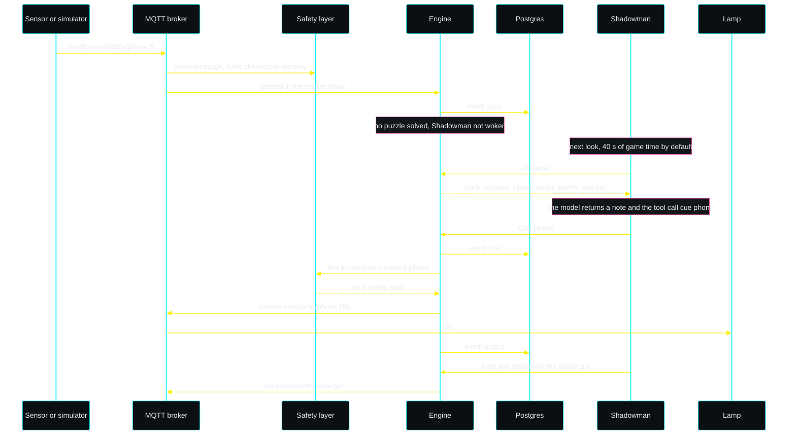

This page describes the whole system and how its parts talk: the hardware and the simulator on MQTT, the engine, Shadowman, the MCP server, the safety layer, voice and the browser. It lists what crosses each boundary, follows one event from a sensor to a lamp, and ends with a map of the repository. So far the system has run only its simulated demo room, [The Core](The-Core). It has not yet run a real venue.

## The parts

*The whole system as one diagram.*

The parts below, with the HTTP API, are one .NET 10 process, assembled in [`Program.cs`](https://github.com/meron1122/EscapeRoomFramework/blob/main/src/EscapeRoom/Program.cs).

| Part | Source | Role |
|---|---|---|
| MQTT connection | [`Mqtt.cs`](https://github.com/meron1122/EscapeRoomFramework/blob/main/src/EscapeRoom/Mqtt.cs) | one broker connection, subscribed to `#`; remembers the last payload of every topic |
| Engine | [`Engine.cs`](https://github.com/meron1122/EscapeRoomFramework/blob/main/src/EscapeRoom/Engine.cs), [`Game.cs`](https://github.com/meron1122/EscapeRoomFramework/blob/main/src/EscapeRoom/Game.cs), [`Room.cs`](https://github.com/meron1122/EscapeRoomFramework/blob/main/src/EscapeRoom/Room.cs) | routes messages to running games, decides puzzles, stores every event, runs output steps |
| Shadowman | [`GameMaster.cs`](https://github.com/meron1122/EscapeRoomFramework/blob/main/src/EscapeRoom/GameMaster.cs) | watches the running game and acts through the engine |
| MCP server | [`McpTools.cs`](https://github.com/meron1122/EscapeRoomFramework/blob/main/src/EscapeRoom/McpTools.cs) | the engine's operations as tools for an outside model |
| Safety layer | [`Safety.cs`](https://github.com/meron1122/EscapeRoomFramework/blob/main/src/EscapeRoom/Safety.cs) | venue-wide devices and rules that no game can reach |
| Voice | [`Voice.cs`](https://github.com/meron1122/EscapeRoomFramework/blob/main/src/EscapeRoom/Voice.cs) | turns a character's line into an mp3 and a URL |
| QR camera | [`QrCamera.cs`](https://github.com/meron1122/EscapeRoomFramework/blob/main/src/EscapeRoom/QrCamera.cs) | makes an RTSP camera an MQTT sensor |

## Hardware and the simulator on MQTT

Every device reaches the engine over MQTT. A room names its devices as inputs and outputs. Presets cover the topic layouts of Tasmota, ESPHome and zigbee2mqtt; anything else is a plain `topic` (see [Rooms as Data](Rooms-as-Data)). An RTSP camera does not speak MQTT, so `QrCamera` reads QR codes with ffmpeg and ZXing and publishes them like any other sensor.

The simulator is a Godot web build with its own MQTT client over WebSocket. It publishes what the room's sensors would and subscribes to what its lamps, doors, screens and speakers would receive, on the same broker. To the engine its topics are ordinary inputs and outputs. It is the only hardware the engine has driven so far (see [The Simulator](The-Simulator)).

| Topic | Direction | Carries |
|---|---|---|
| a room's input topics, e.g. `sim/the-core/lobby/phone` | hardware to engine | a sensor value: the payload, or one field of a JSON payload |
| a room's output topics, e.g. `sim/the-core/lamp/phone` | engine to hardware | the value of a step |
| `escaperoom/<room>/control` | room to engine | `{"command":"start"}`, `{"command":"help"}`, `{"command":"look"}`, `{"speed":n}` |
| `escaperoom/<room>/players` | tracking to engine | the latest snapshot of the players |
| `escaperoom/<room>/state` | engine out, retained | clock, speed, ending, the status of every puzzle |
| `escaperoom/<room>/definition` | engine out, retained | the room as this game plays it |
| `escaperoom/camera/<id>/qr` | `QrCamera` to engine | the text of a QR code |

In this repository only the simulator publishes `players`; there is no tracker for a real room.

## The engine

A room is data: JSON, validated on save, stored in Postgres. A game is a session: its own copy of the room's definition plus its state (the last value of every input, the solved puzzles, the clock). One game runs per room at a time; a unique index enforces it.

| Table | Holds |
|---|---|
| `rooms` | the definition and the brief |
| `sessions` | each game's copy of the definition, its state, start and end |
| `events` | every event of a game, in order |
| `safety_log` | the append-only audit of the safety layer |

The events are `started`, `input`, `gm-input`, `solved`, `output`, `gm-output`, `gm-solve`, `room-updated`, `reroll`, `twist`, `cue`, `help`, and the endings `finished`, `stopped`, `restarted`, `timeout`.

A clock ticks once a second, ends the game when the room's `minutes` run out, and publishes the state. Games that were running when the process stopped are resumed from Postgres. After each logged event the engine raises `Changed(room, type)`. Shadowman listens to that.

## Shadowman and the MCP server

There are two ways for a model to act on a game. Both end in the same engine methods, so the same checks apply to both.

Shadowman is a background service in the engine's process. He does not go through MCP: he calls the engine directly (`Observe`, `Cue`, `Twist`, `Reroll`, `Solve`, `Trigger`) and reaches his model over HTTPS. See [Shadowman the Agent](Shadowman-the-Agent).

The MCP server (Streamable HTTP at `/mcp`) is for a model or an operator outside the process.

| MCP tools | For |
|---|---|
| `list_rooms`, `get_room`, `game_status`, `get_brief`, `list_mqtt_topics` | reading |
| `save_room`, `upsert_input`, `upsert_output`, `upsert_puzzle`, `remove_from_room` | building and rewiring a room, also during a game |
| `start_game`, `stop_game`, `solve_puzzle`, `reroll_variant`, `fire_cue`, `fire_twist` | running a game |
| `simulate_input`, `trigger_output` | standing in for a sensor, driving an output by hand |

## The safety layer

Safety devices and rules belong to the whole venue, outside any room. The rules are evaluated in memory on the MQTT loop, with or without a game. A room whose output would publish to a safety device is rejected on save, and every publication by a game is checked once more before it leaves; a blocked one is written to the audit. Neither Shadowman nor MCP has a tool for this layer. Its configuration changes only through `PUT /safety` with an operator token. See [Safety Layer](Safety-Layer). The README is explicit that this layer is additional and does not replace hardware safety.

## Voice

When a character speaks, `Voice` sends the line to ElevenLabs, or to an ElevenLabs model through OpenRouter, stores the mp3 under a name derived from a hash of model, voice and text, and returns a URL. The URL travels in the MQTT message as `audio`; whatever plays sound in the room fetches it. Without a voice id or credentials the line stays text.

## The browser and HTTP

| Endpoint | Purpose |
|---|---|
| `PUT`, `GET /rooms/{id}` | save (validated) or read a definition |
| `PUT`, `GET /rooms/{id}/brief` | the brief, Markdown |
| `POST /rooms/{id}/start`, `POST /rooms/{id}/stop` | start or end a game |
| `POST /rooms/{id}/puzzles/{puzzle}/solve` | solve a puzzle by hand |
| `GET /rooms/{id}/session` | the latest game |
| `GET /voice/{file}` | a spoken line; only names of 32 hex digits and `.mp3` |
| `GET /safety`, `GET /safety/log`, `PUT /safety` | the safety layer |

The API and MCP have no login and by default answer only for local host names. On the Sprite a proxy is the only public listener: it serves the landing page and the simulator, passes `/mqtt` to the broker's WebSocket door (limited by an ACL generated from the room definition) and `/voice/<hash>.mp3` to the engine, and answers 404 for `/rooms`, `/mcp` and `/safety`. See [Running on Fly Sprites](Running-on-Fly-Sprites).

## One event, from a sensor to a lamp

A player presses a wrong key on the phone in the demo room. Nothing is solved, so nothing wakes Shadowman; he reads the attempt at his next look and lights the cue.

The engine keeps its own queue behind the MQTT loop, so a slow database cannot delay the safety rules that run on that loop.

## Map of the repository

| Path | Contents |
|---|---|
| [`src/EscapeRoom`](https://github.com/meron1122/EscapeRoomFramework/blob/main/src/EscapeRoom) | the engine, Shadowman, safety, MCP, voice, the HTTP API |
| [`tests/EscapeRoom.Tests`](https://github.com/meron1122/EscapeRoomFramework/blob/main/tests/EscapeRoom.Tests) | tests of the game logic, The Core's data, safety and voice |
| [`examples`](https://github.com/meron1122/EscapeRoomFramework/blob/main/examples) | `the-core.json` (the demo room), `lab.json` (a small room on Tasmota, ESPHome, zigbee2mqtt and a camera), `safety.json` |
| [`docs/scenario-the-core.md`](https://github.com/meron1122/EscapeRoomFramework/blob/main/docs/scenario-the-core.md) | the brief of The Core |
| [`simulator`](https://github.com/meron1122/EscapeRoomFramework/blob/main/simulator) | the Godot simulator and the scripts that build its models, music and recorded lines |
| [`site`](https://github.com/meron1122/EscapeRoomFramework/blob/main/site) | the landing page |
| [`deploy`](https://github.com/meron1122/EscapeRoomFramework/blob/main/deploy) | everything for one Fly.io Sprite: build, setup, proxy, broker, ACL generator |
| `docker-compose.yml`, `mosquitto.conf` | Postgres and Mosquitto for local work |

**Next:** [Shadowman the Agent](Shadowman-the-Agent)
