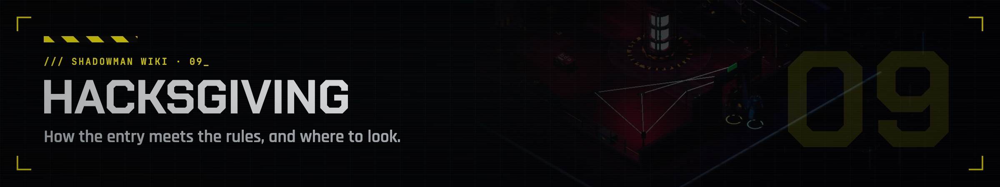
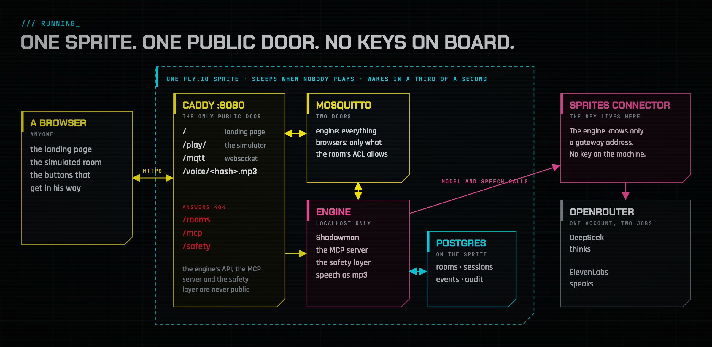
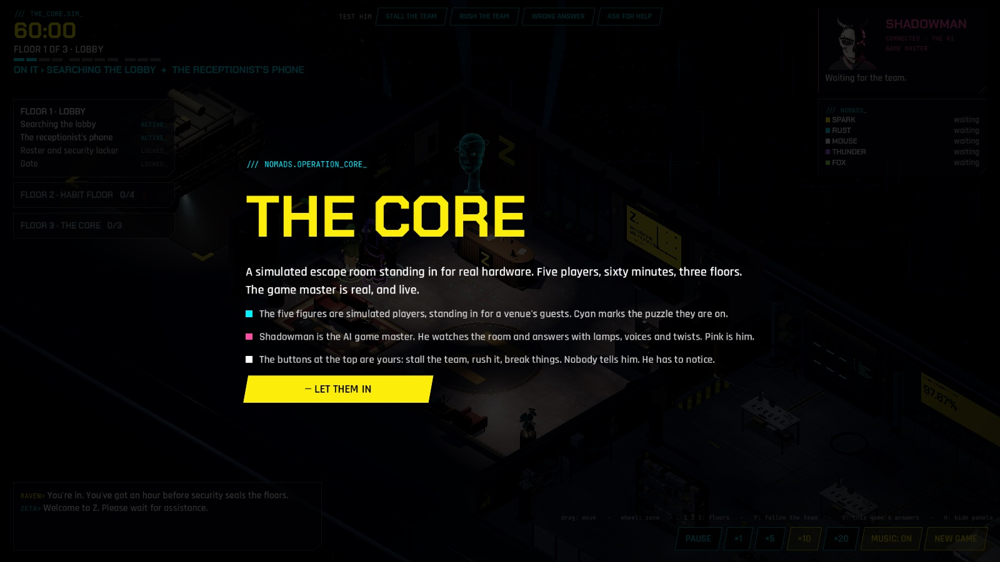
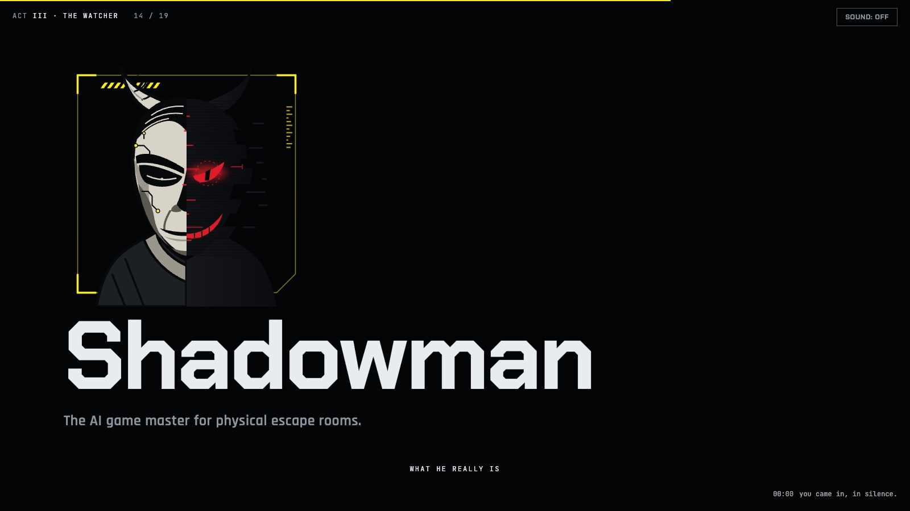

Shadowman is an entry in Fly.io's Hacksgiving. This page says how it meets the rules and what to look at if you have three minutes.

## The two rules

| Rule | How the entry meets it | Where to check |
|---|---|---|
| **The agent runs on a Sprite** | The engine, Shadowman, the MQTT broker, Postgres and the web server all run as services on one Fly.io Sprite. It sleeps when nobody plays and wakes on the next request. | [Running on Fly Sprites](Running-on-Fly-Sprites), [`deploy/`](https://github.com/meron1122/EscapeRoomFramework/tree/main/deploy) |
| **It uses a Sprites Connector** | His model (DeepSeek) and his voices (ElevenLabs) are both reached through one OpenRouter Connector. The engine knows only a gateway address; no key is on the machine or in the repository. | [`deploy/run-engine.sh`](https://github.com/meron1122/EscapeRoomFramework/blob/main/deploy/run-engine.sh), [`src/EscapeRoom/GameMaster.cs`](https://github.com/meron1122/EscapeRoomFramework/blob/main/src/EscapeRoom/GameMaster.cs), [`src/EscapeRoom/Voice.cs`](https://github.com/meron1122/EscapeRoomFramework/blob/main/src/EscapeRoom/Voice.cs) |

## Three minutes

1. Open **[the simulated room](https://shadowman-enp4.sprites.app/play/)**. Skip the story if you are short on time, then let the team in.
2. Look at the pink panel, top right. That is the agent: what woke him, how long he thought and on which model, the note he wrote, the moves he made.
3. Press **STALL THE TEAM**. Nothing tells him what you did. Within a few looks he notices the standstill and answers: usually a lamp over the clue first, words later.
4. Press **ASK FOR HELP**. This one he must answer: a hint in a character's voice, for the puzzle the team is on.
5. Press **WRONG ANSWER**, then read his next note. He sees every wrong value.

If you have longer, the **[landing page](https://shadowman-enp4.sprites.app/)** tells the same thing as a three-minute story.

## What is real and what is simulated

| | |
|---|---|
| **Real** | The agent, his model calls, his notes, the lines he writes and their synthesised speech, the engine, the MQTT traffic, the safety layer, the deployment. |
| **Simulated** | The room and its five players. The simulator publishes the same sensor topics and obeys the same output topics as real devices would. |
| **Recorded** | The room's fixed announcements (as they would be in a real room) and the video clips on the landing page. |
| **Not done yet** | A night in a real venue with real players. |

## What it costs to leave running

A paused Sprite is billed for storage only. Model and speech calls go to OpenRouter and are bounded by two caps in the Sprite's settings: games started from a browser per hour, and characters of speech per day. Details are in [Running on Fly Sprites](Running-on-Fly-Sprites).

## Where everything is

| | |
|---|---|
| The agent | [`src/EscapeRoom/GameMaster.cs`](https://github.com/meron1122/EscapeRoomFramework/blob/main/src/EscapeRoom/GameMaster.cs) · [Shadowman, the Agent](Shadowman-the-Agent) |
| The engine | [`src/EscapeRoom/`](https://github.com/meron1122/EscapeRoomFramework/tree/main/src/EscapeRoom) · [Architecture](Architecture) |
| The demo room | [`examples/the-core.json`](https://github.com/meron1122/EscapeRoomFramework/blob/main/examples/the-core.json), [`docs/scenario-the-core.md`](https://github.com/meron1122/EscapeRoomFramework/blob/main/docs/scenario-the-core.md) · [The Core](The-Core) |
| The simulator | [`simulator/`](https://github.com/meron1122/EscapeRoomFramework/tree/main/simulator) · [The Simulator](The-Simulator) |
| The landing page | [`site/`](https://github.com/meron1122/EscapeRoomFramework/tree/main/site) |
| The deployment | [`deploy/`](https://github.com/meron1122/EscapeRoomFramework/tree/main/deploy) · [Running on Fly Sprites](Running-on-Fly-Sprites) |

## Made of

The engine is .NET 10 with Postgres and MQTT. The simulator is Godot 4, exported for the web; its 3D models are built from code in Blender and its music is synthesised from code. The fonts (Chakra Petch, Rajdhani, JetBrains Mono) are under the Open Font License. The landing page is one HTML file.

**Back to:** [Home](Home)
