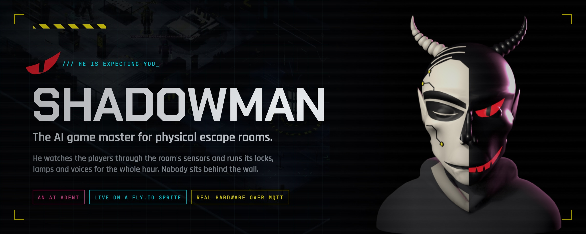

<b><a href="https://shadowman-enp4.sprites.app/">The story</a></b> &nbsp;·&nbsp;
<b><a href="https://shadowman-enp4.sprites.app/play/">Watch him run a room, live</a></b> &nbsp;·&nbsp;
<b><a href="https://github.com/meron1122/EscapeRoomFramework">The code</a></b>

Every escape room has someone behind the wall: a game master who watches the cameras, counts the minutes and decides when a team has struggled long enough to deserve a hint. One person, one room, every single game.

**Shadowman takes that chair.** He is an AI agent that runs a physical escape room live. He reads the venue's own description of the room, watches every sensor and every player, and decides what the room does next: a lamp over a clue, a line in a character's voice, a blackout for a team that is too fast, an answer redrawn before anyone has seen its clue. The players never learn he exists. The exits are not his.

| | |
|---|---|
| **What he is** | An AI agent with tools. Not a script of triggers: he judges when to help, how much, and in whose voice. |
| **What he works through** | An engine that drives real hardware over MQTT: locks, lamps, screens, speakers, sensors, cameras. |
| **What he knows** | Only what the engine sends him. A room is a document; hand him another and he runs another. |
| **What he cannot touch** | The way out, the alarms, the emergency systems. They live in a separate safety layer. |
| **Where he lives** | On one Fly.io Sprite. His model and his voices are reached through a Sprites Connector, so no key is on the machine. |
| **What has been run** | One complete room, "The Core", simulated in a browser on the same bus as real devices. He has not yet run a night in a real venue. |

## Watch him work

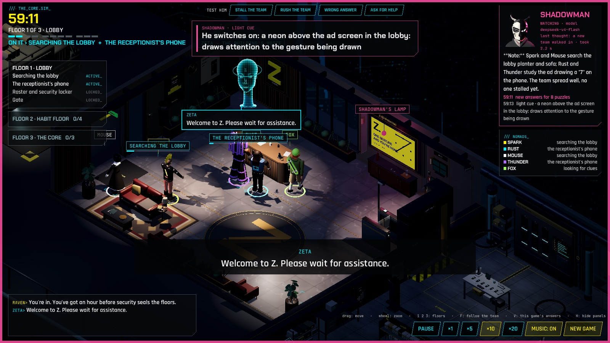

*The simulated room during a game. Top right is him: what woke him, his note, his last moves. The pink lamp is his; so is the line ZETA has just spoken.*

The demo is live. Open [the simulated room](https://shadowman-enp4.sprites.app/play/), let a team in, then get in his way: stall the team, rush it, feed it wrong answers, press its help button. Nobody tells him what you did. He has to notice.

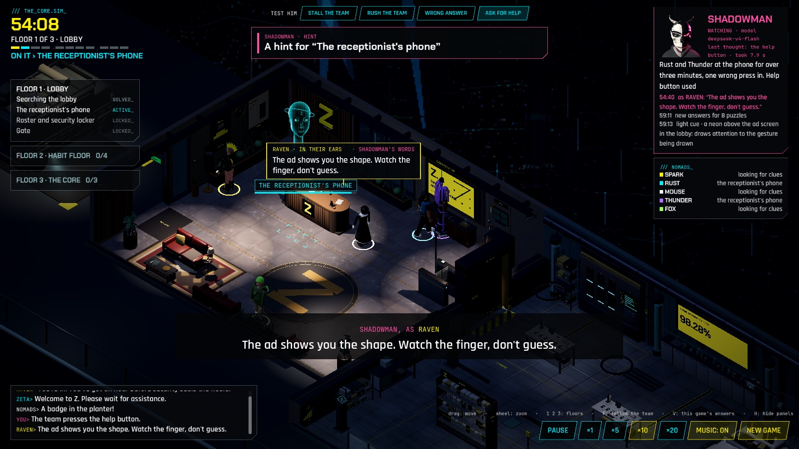

*The help button was pressed. He answers as RAVEN, the crew's hacker, with a hint for the puzzle the team is on.*

## The pages

| | Page | What is in it |
|---|---|---|
| 01 | **[The Idea](The-Idea)** | The chair behind the wall, why it takes an agent, how he treats a team. |
| 02 | **[Architecture](Architecture)** | One bus, one engine, one watcher: the parts and what crosses between them. |
| 03 | **[Shadowman, the Agent](Shadowman-the-Agent)** | What wakes him, what he is shown, his tools, what the code guarantees. |
| 04 | **[Rooms as Data](Rooms-as-Data)** | How a venue describes a room: puzzles, variants, cues, twists, voices, the brief. |
| 05 | **[The Core](The-Core)** | The demo room: three floors, eleven puzzles, five players, two voices. |
| 06 | **[The Simulator](The-Simulator)** | A browser that poses as the room's hardware, and how to read its screen. |
| 07 | **[The Safety Layer](Safety-Layer)** | What must never depend on an AI, and how the code keeps it apart. |
| 08 | **[Running on Fly Sprites](Running-on-Fly-Sprites)** | One small machine, one public door, no keys on board. |
| 09 | **[Hacksgiving](Hacksgiving)** | How the entry meets the rules, and what to look at in three minutes. |

## The whole thing in one picture

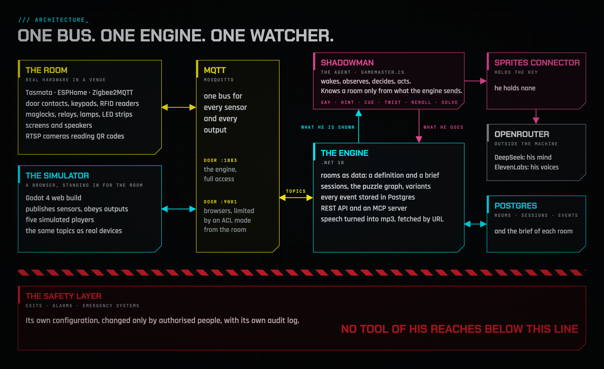

## One night, six pictures

| | | |
|---|---|---|
| 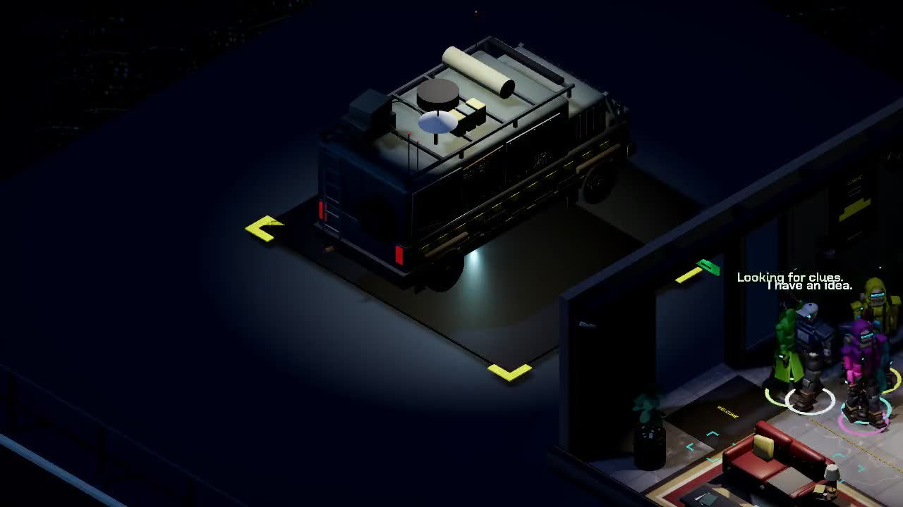 | 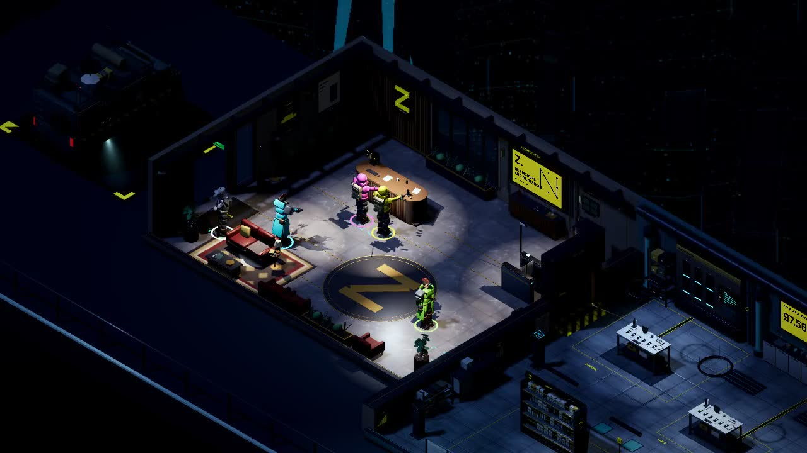 | 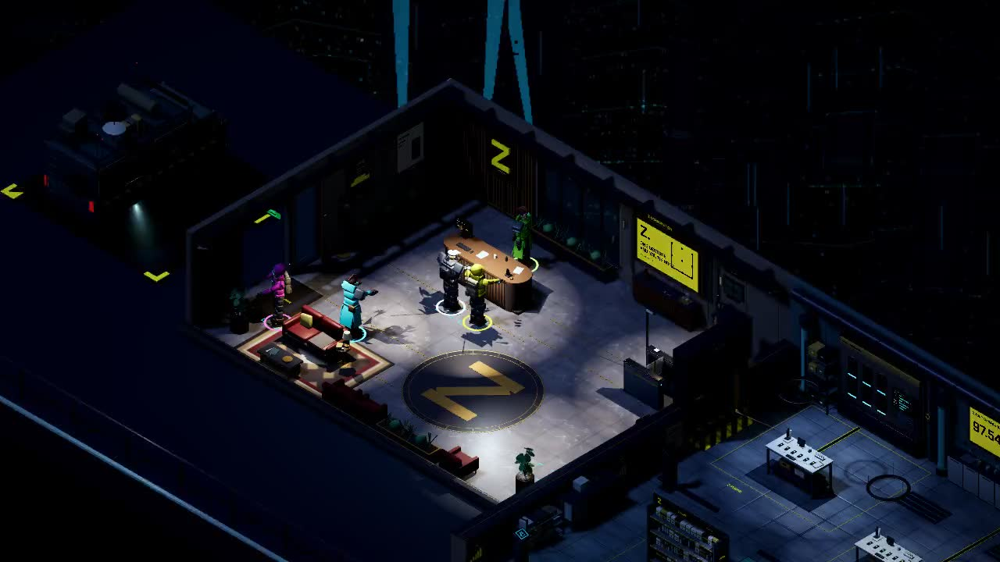 |
| *A van below the tower. Raven stays on the radio.* | *Five friends in the lobby. Sixty minutes.* | *A lamp comes on over the clue. Nobody said a word.* |
| 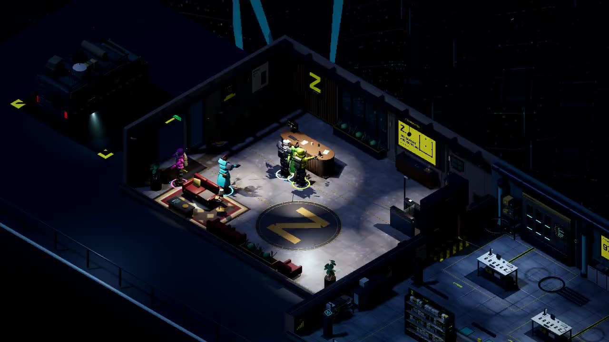 | 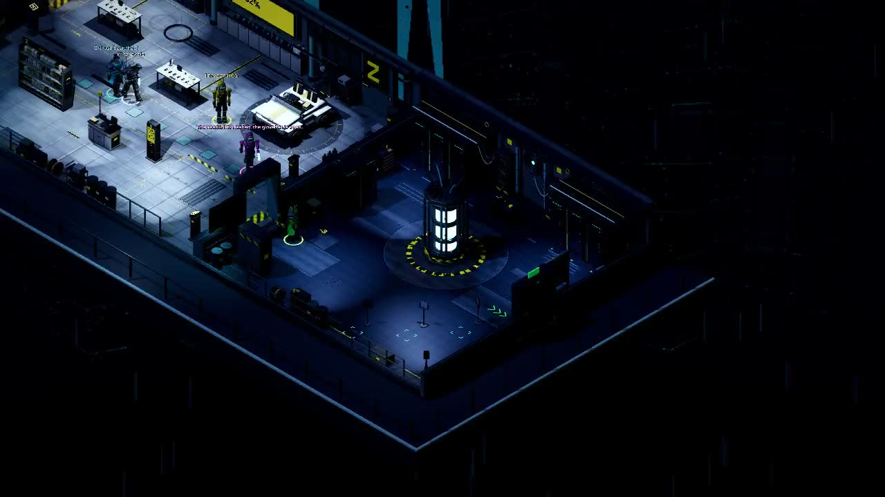 | 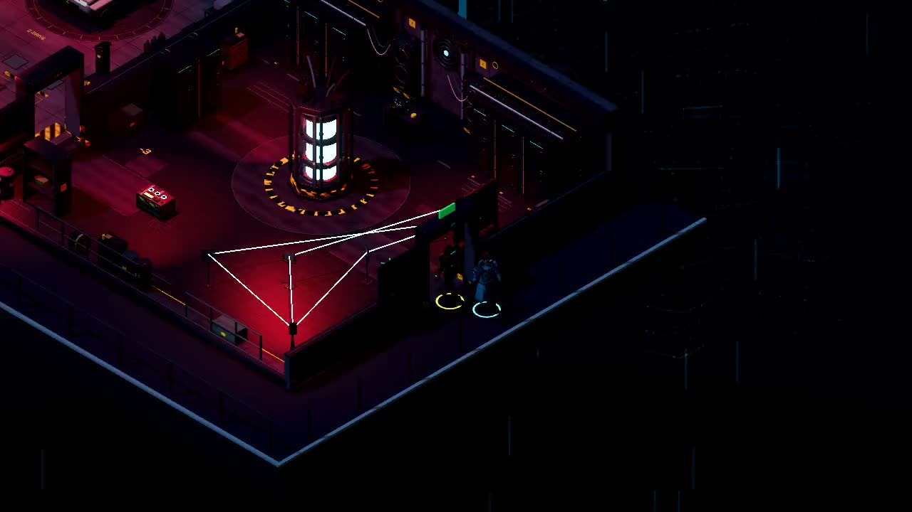 |
| *They were ahead of schedule. He noticed.* | *Three floors down: The Core.* | *Two keys, turned together.* |

## Who is who

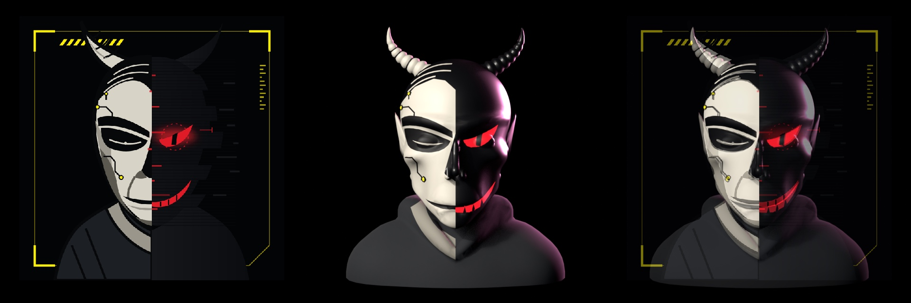

*His logo, his bust in the game's panel, and the two laid over each other.*

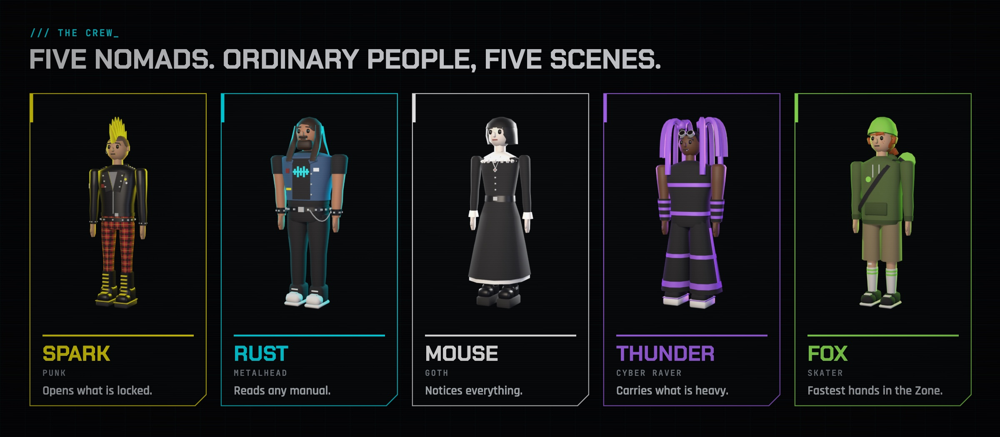

*The crew of the demo room: five simulated players standing in for a venue's guests.*

---

**Start here:** [The Idea](The-Idea)
