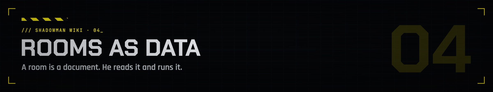
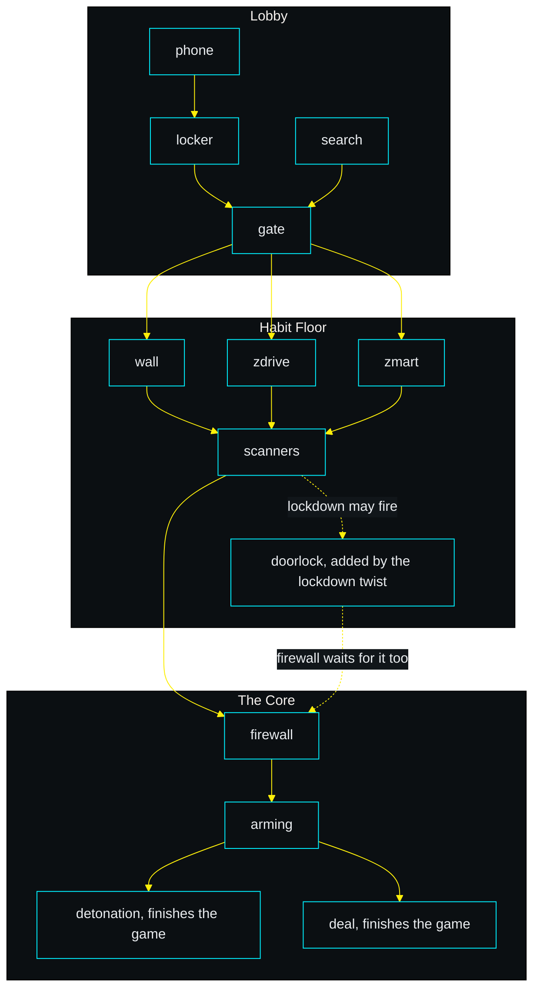

This page describes how a room is written down: its inputs and outputs, its puzzles and their graph, conditions, steps and the start, and what the venue adds for Shadowman: characters, variants, twists, cues, hints and the brief. It ends with what a change made during one game does and does not touch. The excerpts come from [`examples/the-core.json`](https://github.com/meron1122/EscapeRoomFramework/blob/main/examples/the-core.json), the demo room, which has so far been played only in the simulator.

## The shape of a room

A room is one JSON document: the record `Room` in [`Room.cs`](https://github.com/meron1122/EscapeRoomFramework/blob/main/src/EscapeRoom/Room.cs).

| Field | Meaning |
|---|---|
| `name` | the room's name |
| `inputs`, `outputs` | the room's devices, by id |
| `puzzles` | the puzzle graph |
| `start` | steps run when a game starts |
| `minutes` | the game's length; when the clock reaches it the game ends as `timeout` |
| `characters` | the voices Shadowman speaks with |
| `variants` | alternative solutions, each with its clue |
| `twists` | prepared changes to a game |
| `cues` | wordless hints built into the room |

Only `name`, `inputs`, `outputs` and `puzzles` are required. The demo room has 31 inputs, 26 outputs, 12 puzzles, 2 characters, 10 cues, 3 twists and 9 sets of variants.

## Inputs and outputs

An input is something the room reports; an output is something the room does. Each is one MQTT endpoint and sets exactly one of `topic`, `tasmota`, `esphome`, `z2m` or `camera`. A camera can only be an input.

```json
"phone_key":      { "topic": "sim/the-core/lobby/phone" },
```

```json
"lamp_phone": { "topic": "sim/the-core/lamp/phone" },
```

The demo room uses plain topics only, because its hardware is the simulator. [`examples/lab.json`](https://github.com/meron1122/EscapeRoomFramework/blob/main/examples/lab.json) shows the presets: `{ "tasmota": "trap-buttons", "path": "Button1.Action" }` listens on `stat/trap-buttons/RESULT`. `path` picks one field of a JSON payload; without it the value is the whole payload.

Two output names mean something to Shadowman. `gm` receives his notes and `hint` learns which puzzle got help. Both are optional.

## Puzzles and their graph

```json
{
  "id": "gate", "name": "Gate", "hints": ["The gate lets in only one person from security.", "Show the camera the badge of today's duty guard."], "after": ["locker", "search"],
  "when": { "input": "gate_qr", "equals": "SECURITY-MAREK" },
  "then": [ { "output": "door_elevator", "value": "open" } ]
},
```

| Field | Meaning |
|---|---|
| `after` | puzzles that must be solved first; until then the puzzle is `locked`, after that `active` |
| `when` | the condition that solves it; without one it can only be solved by hand |
| `then` | steps run when it is solved |
| `ends` | solving it ends the game; a room may have several endings |
| `name`, `hints` | for Shadowman: a readable name and the venue's prepared hints, gentlest first |

`after` makes the graph: parallel branches and their joins. A room with no `ends` puzzle finishes when every puzzle is solved.



*The demo room's puzzles on its three floors. Solid lines are `after`. Dotted lines exist only in a game where the lockdown twist has fired: it can fire once `scanners` is solved, and `firewall` then also waits for `doorlock`.*

## Conditions

| Form | Holds when |
|---|---|
| `{"input": "x", "equals": v}` | the input's last value equals `v`, compared as text, ignoring case |
| `{"input": "x", "gt": n}`, `{"input": "x", "lt": n}` | the value is a number above, or below, `n` |
| `{"input": "x"}` | the input has reported any value |
| `{"all": [...]}`, `{"any": [...]}` | all, or any, of the inner conditions hold |
| `{"sequence": [...]}` | the last matching events arrived in this order |

A pair of `gt` and `lt` makes a tolerance, as on the knobs of the demo room's car cockpit:

```json
{ "input": "knob_pressure", "gt": 2.35 }, { "input": "knob_pressure", "lt": 2.45 },
```

A sequence must be the whole `when`. Only events that match one of its steps count, and only the last ones, so a mistake does not block the game. Any other condition is checked against the last value of every input: a sensor already in position solves the puzzle the moment it becomes active.

## Steps and the start

A step publishes a value to an output, or waits: `{ "output": "lamp_phone", "value": "ON" }`, `{ "delay": 12000 }` (milliseconds). The value may be any JSON. `start` is the list of steps run when a game begins. In the demo room it closes the three doors and puts the default clues in place:

```json
{ "output": "door_elevator", "value": "closed" },
```

```json
{ "output": "screen_ad", "value": { "gesture": "Z" } },
```

## Characters

```json
{
  "name": "RAVEN", "output": "voice", "voice": "harry",
  "about": "A Nomad from the crew in the van below the tower, talks over the radio. Short, street-wise, always on the players' side. Gives hints."
},
```

`output` is where a line is published, `voice` is the text-to-speech voice, and an optional `screen` is an output that shows the text. The first character in the list speaks the prepared hints when the code has to answer in Shadowman's place.

## Variants

A set of variants is a list of at least two alternatives under one key. Each carries `solutions` (a new `when` for one or more puzzles), `clues` (steps that put the matching clue into the room) and a `summary`.

```json
{"solutions": {"locker": {"input": "locker_code", "equals": "1018"}, "gate": {"input": "gate_qr", "equals": "SECURITY-TOMEK"}}, "clues": [{"output": "screen_roster", "value": {"duty": "Tomek", "shifts": {"Marek": [14, 22], "Ola": [22, 6], "Tomek": [10, 18]}}}], "summary": "Tomek on duty, code 1018"},
```

Solution and clue are drawn together, so the puzzle stays solvable. Here the roster screen puts Tomek on the 10 to 18 shift, the locker takes 1018 and the gate takes Tomek's badge: one alternative sets two linked puzzles. A test checks this for every `locker` variant.

After the first game minute a draw is refused for any puzzle that is no longer locked, because players may already be reading its clue.

## Twists

A twist is a prepared change that can fire once per game. `then` are its steps, `adds` are puzzles that join the game, `blocks` are puzzles that then also wait for the added ones, and `after` names what must already be solved. It cannot fire once a `blocks` puzzle is solved.

```json
"patrol": {
  "about": "ZETA announces a patrol on the Habit Floor: for 20 seconds nobody may move.",
  "after": ["gate"], "blocks": ["scanners"],
  "then": [ { "output": "twist", "value": { "kind": "patrol", "seconds": 20 } } ]
},
```

The demo room's `lockdown` closes the way down to The Core again, adds the puzzle `doorlock` and makes `firewall` wait for it. Variants that concern only added puzzles are drawn when the twist fires.

## Cues and hints

A cue is a wordless hint built into the room: steps and a description, optionally tied to a puzzle. It can fire any number of times; tied to a puzzle, only while that puzzle is active.

```json
"phone": { "puzzle": "phone", "about": "A neon above the ad screen in the lobby: draws attention to the gesture being drawn.",
  "then": [ { "output": "lamp_phone", "value": "ON" }, { "delay": 12000 }, { "output": "lamp_phone", "value": "OFF" } ] },
```

`hints` on a puzzle are the venue's own words, gentlest first. With a model, Shadowman is told to start from them. Without one, they are all he says.

## The brief

The brief is a Markdown document stored with the room (`PUT /rooms/{id}/brief`, at most 100 000 characters; the room must exist first). The venue writes it as it would for a human game master: story, mood, characters, what the puzzles look like, pacing, direction. It is not checked against the definition. Where the two disagree during a game, Shadowman is told to trust the live data. The demo room's brief is [`docs/scenario-the-core.md`](https://github.com/meron1122/EscapeRoomFramework/blob/main/docs/scenario-the-core.md).

## What a per-game change touches

Each game plays its own copy of the definition. Draws and twists change that copy.

| Change | The stored room | This game's copy | Progress |
|---|---|---|---|
| a variant drawn | untouched; it keeps the authored default that the `start` clues match | the puzzles' `when` replaced; the clue steps run | kept |
| a twist fired | untouched | puzzles added, blocked puzzles made to wait; its steps run | kept |
| a cue fired | untouched | untouched; its steps run | kept |
| a puzzle solved by hand | untouched | untouched | the puzzle is solved and its `then` runs |
| the room saved (HTTP or MCP) | replaced | replaced at once by what was saved | kept |

After any change to a game's copy, every active puzzle whose condition already holds is solved and runs its steps. None of these changes touches the brief or the safety layer.

## Validation

A definition is checked when it is saved. Unknown fields are errors, so the typo `"equal"` fails instead of matching any value. So do references to things that do not exist, cycles in `after`, and any output that would publish to a device of the safety layer. A rejected definition changes nothing.

**Next:** [The Core](The-Core)
