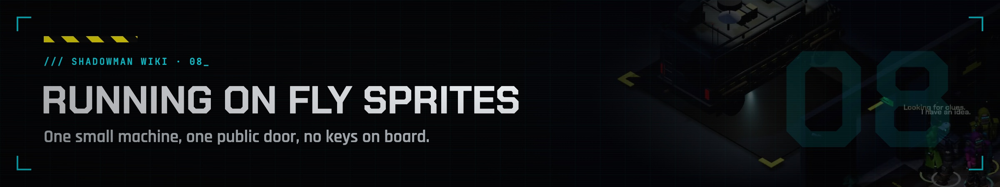
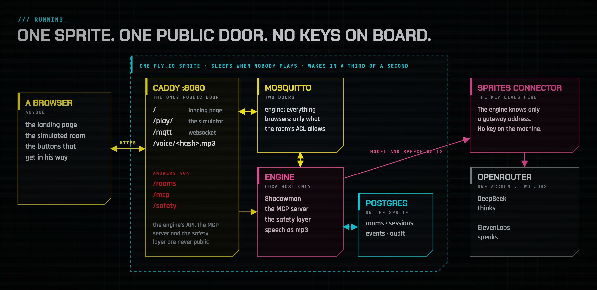
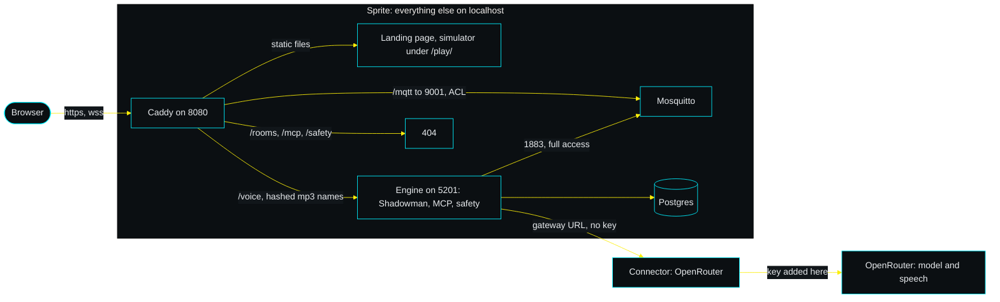

The demo runs on one Fly.io Sprite: the engine with Shadowman, the landing page, the simulator's web build, Postgres and the MQTT broker. This page covers the services, what is public and what answers 404, the broker's two doors and its generated ACL, the Connector that holds the keys, the spending caps, the cost, how to deploy it, and the lessons recorded in [`deploy/README.md`](https://github.com/meron1122/EscapeRoomFramework/blob/main/deploy/README.md). What is hosted is the simulated room; no real venue has run on it. Live: <https://shadowman-enp4.sprites.app> and, for the room, <https://shadowman-enp4.sprites.app/play/>.

## One Sprite, four services



*The Sprite and its services.*

[`setup.sh`](https://github.com/meron1122/EscapeRoomFramework/blob/main/deploy/setup.sh) registers four services with the Sprite's own runtime.

| Service | Listens on | What it does |
|---|---|---|
| `postgres` | localhost | rooms, games, events, the safety audit |
| `mosquitto` | localhost, two listeners | the MQTT bus between the engine and the browsers |
| `engine` | `127.0.0.1:5201` | the engine, `GameMaster`, the MCP server, the safety layer; needs the two above |
| `web` | `:8080`, the only public port | Caddy: static files and two proxied paths; needs `engine` |

The engine is published self-contained for linux-x64, so the Sprite needs no .NET. The packages' own system services stay off: "the Sprite runtime owns the processes, so they survive sleep and wake".



## Public, and 404

| Path | Public | Why |
|---|---|---|
| `/` | yes | the landing page; the simulator is under `/play/` |
| `/mqtt` | yes, limited | a browser acts as the room's hardware; the ACL decides what it may touch |
| `/voice/<hash>.mp3` | yes | spoken lines; names are content hashes |
| `/rooms`, `/mcp`, `/safety` | no, 404 | the engine API, the MCP server and the safety layer have no login, so they stay on localhost |
| Postgres, MQTT over TCP | no | localhost only |

The rule in the [`Caddyfile`](https://github.com/meron1122/EscapeRoomFramework/blob/main/deploy/Caddyfile):

```
@private path /rooms* /mcp* /safety* /voice*
handle @private {
	respond 404
}
```

A `/voice` name that is not 32 hex digits and `.mp3` falls under it too. An operator reaches the private paths with `sprite proxy 5201`.

## The broker's two doors

```
# Door 1: the engine, on localhost only. Full access.
listener 1883 127.0.0.1
allow_anonymous true

listener 9001 127.0.0.1
protocol websockets
allow_anonymous true
acl_file /home/sprite/app/deploy/browser.acl
max_connections 40
```

Both doors are anonymous. The first cannot be reached from outside. The second is the one Caddy proxies, and its ACL is written by [`make-acl.py`](https://github.com/meron1122/EscapeRoomFramework/blob/main/deploy/make-acl.py) from the room definition at build time, so it always matches the room's real input topics:

```
topic read escaperoom/the-core/#
topic read sim/the-core/#
topic write escaperoom/the-core/control
topic write escaperoom/the-core/players
topic write sim/the-core/core/accept
```

The file goes on with one `topic write` line per input, 31 in all. A browser can read the room and write only where its sensors write, plus the control and player-tracking topics. It cannot write to an output (voice, screens, doors, lamps, twists) or to another room. The script stops the build if an input and an output share a topic, or if an input topic holds a wildcard.

## The Connector: no key on the machine

One Sprites Connector, the built-in OpenRouter one, carries both the model and the speech: OpenRouter serves ElevenLabs speech models on `/v1/audio/speech`. It is limited to Sprites with the label `escaperoom`.

The engine knows only the Connector's gateway URL. It sits in `env` twice, as `GAMEMASTER_GATEWAY` and `VOICE_GATEWAY`, and [`run-engine.sh`](https://github.com/meron1122/EscapeRoomFramework/blob/main/deploy/run-engine.sh) turns it into settings:

```bash
if [ -n "${GAMEMASTER_GATEWAY:-}" ]; then
  export GameMaster__Provider=openrouter
  export GameMaster__BaseUrl="$GAMEMASTER_GATEWAY"
  export GameMaster__Model="${GAMEMASTER_MODEL:-deepseek/deepseek-v4-flash}"
  [ -z "${GAMEMASTER_CHAT_PATH:-}" ] || export GameMaster__ChatPath="$GAMEMASTER_CHAT_PATH"
else
  export GameMaster__RulesOnly=true
fi
```

The gateway adds the key on the way out. With the gateways left empty he runs on rules only and the characters' lines stay text. Any OpenRouter model with tool calling works; the default speech model is `elevenlabs/eleven-v3`.

## Spending caps and cost

| In `env` | Effect |
|---|---|
| `GAME_STARTS_PER_HOUR` | start commands over MQTT beyond the cap are refused and logged; the HTTP API and MCP are not capped |
| `VOICE_CHARACTERS_PER_DAY` | beyond it lines stay text; a line already spoken is cached and costs nothing |

`env.example` sets six games an hour and 4000 characters a day. Two more brakes are in the code: his routine look comes no more often than every six real seconds, and spoken lines are cached by model, voice and text.

The cost figures below are the ones recorded in `deploy/README.md`; they were not rechecked for this page.

- The Free plan covers $5 of usage a month. A running Sprite is billed for CPU and memory, a paused one only for storage.
- A Sprite pauses after about 30 seconds without activity and wakes on the next request, so the demo costs money only while someone watches: about $0.03 an hour, or around 150 watched hours a month within the plan.
- Model and speech calls are billed by OpenRouter, not by Fly. With the default model a full sixty-minute game costs roughly ten cents.

## Deploying

1. Install the `sprite` CLI, run `sprite login`, then `sprite create shadowman --label escaperoom --skip-console`.
2. In the dashboard, add the built-in OpenRouter Connector, limited to the label.
3. Build locally and send the bundle over:

```bash
deploy/build.sh
sprite file push -s shadowman deploy/bundle.tgz /home/sprite/bundle.tgz
sprite exec -s shadowman -- bash -c "cd /home/sprite && tar xzf bundle.tgz && bundle/deploy/setup.sh"
```

4. The first run creates `/home/sprite/app/env`, with a generated database password, and stops. Fill in the public URL and the gateway URL, then run the same command again. It installs Postgres, Mosquitto and Caddy, registers the services, loads the room and its brief, and prints the public checks: `/` 200, the rest 404.
5. Check the Connector from inside the Sprite, then `sprite url update -s shadowman --auth public`.

To update: build, push, run `setup.sh` again. It stops and recreates the services, because a running one keeps its old binary. Caddy sends `Cache-Control no-cache`, so nobody plays a stale build after a deploy.

## Lessons recorded

Verified on a real Sprite on 27 Nov 2026, according to `deploy/README.md`:

- **A size limit that dropped the room in silence.** Mosquitto's `message_size_limit` is the broker's, not a listener's. At 8 kB it dropped the engine's room definition (about 35 kB); the browser never learned what an answer looks like, and no puzzle was ever solved by the team. It is 256 kB now.
- WebSocket upgrades pass through the public `*.sprites.app` URL: `/mqtt` answers `101 Switching Protocols`.
- The model answers through the gateway in two to five seconds; speech returns an mp3 in about three.
- The built-in ElevenLabs Connector refuses text to speech. A Custom API Connector that forwards to ElevenLabs is the documented alternative.
- From outside, `/rooms`, `/mcp`, `/safety` and unknown `/voice` names answer 404.

Still open:

- One game runs at a time. A second viewer's start ends the first viewer's game.
- Whether the gateway overrides the placeholder `Authorization` header the Anthropic SDK sends. This concerns Claude models; the default model goes through chat completions.

The agent behind these services is described in [Shadowman the Agent](Shadowman-the-Agent); what the proxy keeps private, in [Safety Layer](Safety-Layer).

**Next:** [Hacksgiving](Hacksgiving)
