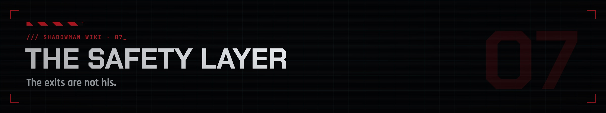
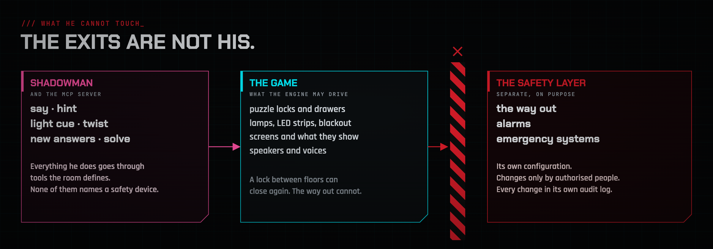
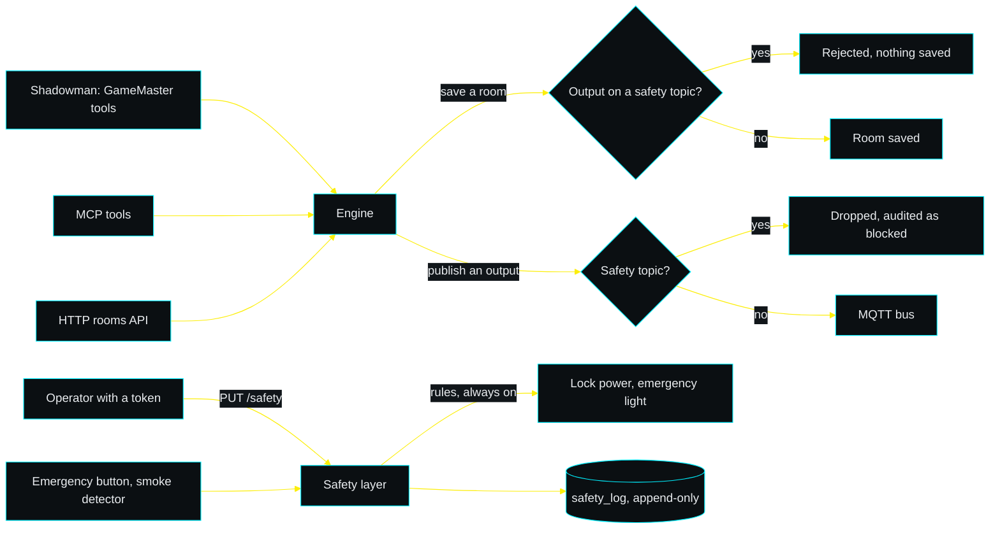

An agent that runs a room must not be able to run its exits. This page covers what the safety layer holds, how a change to it is authorised and audited, why neither Shadowman's tools nor the MCP server have a way into it, and what the tests check. It separates what the code does today from what is only intended. The project has run only its simulated room so far, so none of this has been exercised in a real venue.

## What must never depend on an AI

The README names them: the emergency button, the smoke detector, cutting power to the locks, emergency lighting. They are one category for the whole venue, independent of rooms and games.

The software layer is additional. It does not replace hardware safety: electric locks must release when power is lost, and the emergency button must physically cut their power, independently of this server, the network and the broker. Restoring power after an alarm is deliberately left to a person.



*What he can reach, and what he cannot.*

## What the layer holds

[`Safety.cs`](https://github.com/meron1122/EscapeRoomFramework/blob/main/src/EscapeRoom/Safety.cs) holds one configuration for the venue: safety inputs, safety outputs and rules. The example in [`examples/safety.json`](https://github.com/meron1122/EscapeRoomFramework/blob/main/examples/safety.json) has one rule:

```json
"when": { "any": [ { "input": "emergencyButton", "equals": "ON" }, { "input": "smoke", "equals": true } ] },
"then": [ { "output": "lockPower", "value": "OFF" }, { "output": "emergencyLight", "value": "on" } ]
```

- Rules run with or without a game. They are evaluated in memory, on the MQTT loop.
- They are level-triggered: while a rule holds, every new value on a safety input sends its outputs again, for a lock controller that has rebooted.
- Firing runs off the loop. It writes `fired` to the audit, then publishes the outputs. A failed audit write is logged as critical and does not stop them.
- A rule cannot be a `sequence`.
- The layer loads before the application serves anything, "so no game can publish while the safety config is still unknown".
- Each MQTT listener is called on its own, so a failing game handler cannot keep a message from the safety layer.

A safety device owns more than one topic. `Io.Owns` covers whatever could command, reconfigure or impersonate it:

| Device in the example | Topics it owns |
|---|---|
| Tasmota `lock-power` | `cmnd/lock-power/`, `stat/lock-power/`, `tele/lock-power/` and the broadcast `cmnd/tasmotas/` |
| ESPHome `safety-panel` | everything under `safety-panel/` |
| zigbee2mqtt `smoke_lab` | `zigbee2mqtt/smoke_lab`, everything under it, and `zigbee2mqtt/bridge/` |
| a plain topic | that exact topic |

## Two checks keep a game out



**On save.** `Engine.SaveRoom` is the one path for `PUT /rooms/{id}` and for every MCP tool that changes a room. It rejects a room with an output on an owned topic: "games cannot drive safety devices".

**On publish.** Both places where the engine publishes to a room's output, steps and direct outputs, first call `safety.Blocks`. A blocked publish is dropped, logged and audited as `blocked`. This second check is the one that holds if the safety configuration changes after a room was saved.

## No way in for Shadowman or MCP

- `GameMaster` is constructed with the engine, the voice service, configuration and a logger. He holds no reference to `Safety` or to the broker.
- His tools are `solve`, `say`, `hint`, `reroll`, `cue` and `twist`, plus `note` for chat models. Each acts through the engine, so everything he publishes passes the block above.
- His prompt says exits and emergency systems are not his. The limit is the code, not that sentence.
- [`McpTools.cs`](https://github.com/meron1122/EscapeRoomFramework/blob/main/src/EscapeRoom/McpTools.cs) has eighteen tools and none for safety: `// Deliberately no tool changes, triggers or simulates anything in the safety layer.` It reads the layer only to mark topics in `list_mqtt_topics` as `safety: true`.
- `simulate_input` feeds a value to the game, not to the bus, so it cannot fake a safety sensor.

The safety endpoints are separate from the game API: `GET /safety`, `GET /safety/log`, `PUT /safety`.

## Changing it: a token and an audit

A change is `PUT /safety` with the header `X-Safety-Token` and a body of `reason` and `config`. `Safety.Change` works in this order:

1. Authorisation first, so every attempt is audited. The server holds only the SHA-256 of each operator's token (`Safety:Operators:<name>`), compared in fixed time. No match: `denied` with the caller's IP, and 401.
2. A malformed body, a missing `reason` or a configuration that fails validation: `rejected`, and 400.
3. Otherwise the change is written to the audit as `config`, with the operator, the IP, the reason and the whole configuration, before it takes effect. If that write fails, the change does not happen.

The audit is also the store: on start the layer loads the last `config` row. The table is append-only:

```sql
create or replace trigger safety_log_append_only before update or delete or truncate on safety_log
    for each statement execute function safety_log_append_only();
```

Besides `denied`, `rejected` and `config` it records `fired`, `output` and `failed` for rules, and `blocked` for a game's attempt.

## What the tests check

[`SafetyTests.cs`](https://github.com/meron1122/EscapeRoomFramework/blob/main/tests/EscapeRoom.Tests/SafetyTests.cs) covers the pure logic:

- The example is valid and does not conflict with the lab room.
- Eight topics are protected, and a room with an output on any of them gets exactly one conflict: the relay itself, another command to the same device, the Tasmota broadcast, its reports, the emergency button's state, the smoke detector, the zigbee2mqtt bridge, the emergency light.
- Three look-alikes stay usable, for example `cmnd/lock-power-2/Power1`.
- The rule holds when smoke is reported and not when both inputs are quiet, and a `sequence` rule is refused.

There is no test for the token check, the audit order, the Postgres trigger, the publish-time block or a rule firing over MQTT. Those need a database or a broker.

## Implemented and intended

| | State |
|---|---|
| Rules, ownership, both checks, the operator token, the append-only audit | implemented |
| Login for the HTTP API, MCP and the broker | not there yet. `GET /safety` and `GET /safety/log` answer whoever reaches the engine; on the Sprite the proxy answers 404 instead |
| Broker ACLs that keep other MQTT clients off safety topics | left to the deployment |
| A database role that does not own `safety_log` and cannot drop the trigger | left to the deployment. The repository's own setups connect as the role that created the table |
| Safety devices kept out of zigbee2mqtt groups | left to the deployment |
| A real alarm that cannot be mistaken for the detonation | only in the brief: "This rule still has to be added to the safety layer." |
| A safety configuration on the demo | `setup.sh` loads the room and its brief, and no safety configuration |

How the demo keeps the engine off the internet is in [Running on Fly Sprites](Running-on-Fly-Sprites).

**Next:** [Running on Fly Sprites](Running-on-Fly-Sprites)
