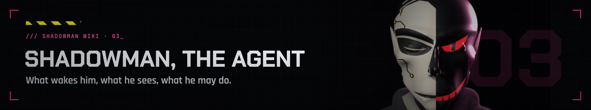
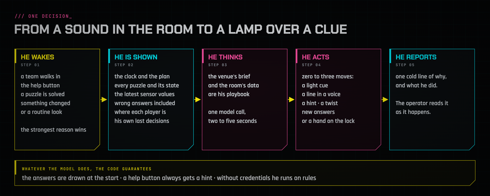
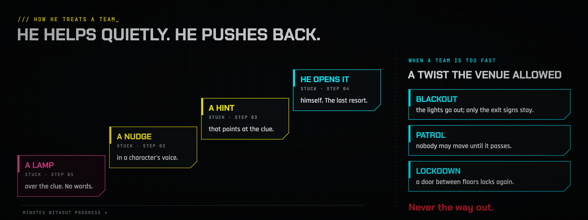
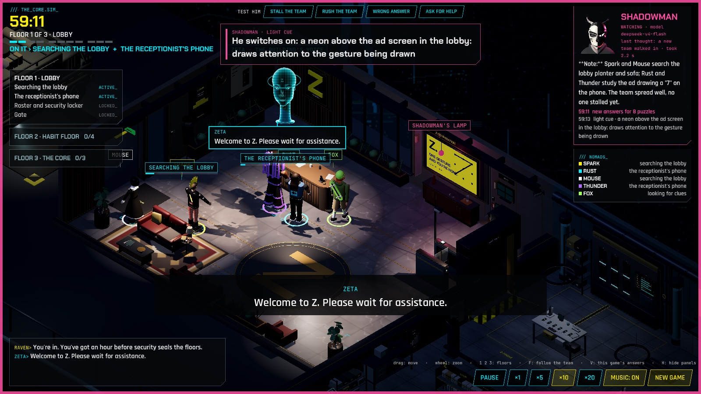

This page describes how Shadowman works: what wakes him, what he is shown, his playbook and tools, what the code guarantees whatever the model does, his notes, his models and his speech. In code he is the class [`GameMaster`](https://github.com/meron1122/EscapeRoomFramework/blob/main/src/EscapeRoom/GameMaster.cs). Everything quoted from him here comes from simulated games of [The Core](The-Core); he has not yet run a real venue.

## Room-agnostic by design

`GameMaster.cs` holds no room: no puzzle id, no solution, no cast. Everything he knows about a room arrives from the engine: the brief and the room's data when a game starts, the live game on every look.

His tools follow the room too: the speakers are its characters, and the cues, twists and variants are its own keys. A room without cues gives him no `cue` tool.

He runs one game at a time; a new game takes him over.

## What wakes him

*One decision, from waking to acting.*

| Reason | Source | Weight |
|---|---|---|
| `started` | a new game | 4 |
| `help` | the room's help button | 3 |
| `solved` | a puzzle solved in his room | 2 |
| `look` | an operator asks him to look now | 1 |
| `tick` | a timer: 40 seconds of game time by default, never under 6 real seconds | 0 |

After waking he waits two seconds, so a burst of events becomes one decision. The strongest reason wins. Nothing else wakes him: a wrong code is read at his next look.

## What he is shown

Each decision is one model call with one JSON message.

| Field | Content |
|---|---|
| `reason` | why he woke |
| `mustDo` | on `help` only: call `hint` now |
| `alreadyDone` | what the code already did this turn |
| `game.clockMinutes`, `game.minutes` | the clock and the game's length |
| `game.puzzles` | each puzzle's status, `after`, `ends`, and `when`, its live solution |
| `game.inputs` | the last value of every input, wrong attempts included |
| `game.recent` | the last 25 events |
| `game.players` | the latest tracking snapshot |
| `game.twistsUsed` | twists already fired |
| `yourRecentDecisions` | his last six notes, each with what he did |

The engine passes `players` on without reading it. In this repository only the simulator sends it: each player's name, floor, position, activity, task and minutes without progress.

## The playbook

When he takes a game he gets one document for all of it: the venue's brief, then the room's data. The data lists the room's name and length, the characters, the keys of the variants, the cues, the twists and every puzzle's prepared hints.

It holds no solutions. Those come with each observation, and the prompt settles any conflict: "The JSON you get wins over the brief: its variants and solutions are the live ones."

## The tools

| Tool | What it does | Checked in code |
|---|---|---|
| `say` | a character speaks a line | the speaker is one of the room's characters |
| `hint` | a character gives a level 1 to 3 hint for a puzzle | the puzzle is active |
| `cue` | fires a wordless cue: a lamp, a sign | the cue exists; its puzzle is active |
| `twist` | fires a prepared twist | once per game; `after` solved, `blocks` not |
| `reroll` | draws new variants, solution and clue together | after the first game minute, only puzzles still locked |
| `solve` | marks a puzzle solved; its steps run | the puzzle is active |

A rejected call changes nothing and returns to him among his recent decisions.

*His ladder of help, and twists for fast teams.*

The order is in the prompt, not in code. A cue comes before words. About three minutes behind, a nudge; about six, a hint that points at the clue; about ten, a level 3 hint or `solve`. For a team well ahead, one twist at a time.

## What the code guarantees

- **Variants are drawn at the start.** On `started`, before the model is asked, the code has the engine draw the variants of every puzzle in the game and reports the result in `alreadyDone`.
- **A help button is answered.** If a `help` decision ends without a hint, the code speaks the venue's next prepared hint for an active puzzle, as the room's first character. The room must have both.
- **Without credentials the game still runs.** With `GameMaster:RulesOnly`, or once a call fails for lack of working credentials, he runs on rules. By minutes since the last solve: after three a cue or the first prepared hint, after six the next hint, after ten the puzzle is solved. Any other failure, or a refusal, means rules for that one decision.
- **Model output is untrusted.** Every field of a tool call is checked before anything happens.
- **The safety layer is out of reach.** He has no tool for it, and the engine refuses any publication to a safety topic. See [Safety Layer](Safety-Layer).

## His notes

The prompt asks for one short note before any tool call, "the way an unseen observer keeps a log: cold, exact, in the third person, naming players". The note and what he did go to the room's `gm` output, if it has one, and into his memory: the last six return with each observation. The memory is cleared when he takes a new game.

*The simulator during a game. His panel shows why he woke, his last note and his last moves.*

From his log of simulated games of The Core:

| His note | What he did |
|---|---|
| "Rust and Mouse stalled 3.3 min on the phone, pressed 5 and 2 — not the U. Cue the ad neon." | light cue: phone |
| "Fox and Rust at minute 15 keyed 2188 — 2-1-8-8, still wrong. Roster says Tomek 10–18 = 1018. Lobby 7 minutes behind plan." | ZETA: "Is there a problem with the locker, guests? Security codes are simple." |
| "Rust and Mouse still on key 8, level 3 hint given 90s ago. Spark idle with badge. Lobby 8 min behind." | RAVEN: "Rust, one-two-three-five-seven. Now, before security notices." |

The details trace back to the room's data: "the U" and one-two-three-five-seven are `phone` variants, "Tomek 10–18 = 1018" a `locker` variant. The players are simulated.

## Models and API paths

| Configuration | Endpoint | API |
|---|---|---|
| default | Anthropic; the SDK finds `ANTHROPIC_API_KEY` or an `ant auth login` profile | Messages |
| `GameMaster:BaseUrl` set | a gateway that holds the key | Messages |
| OpenRouter, a Claude model | `https://openrouter.ai/api` or a gateway | Messages, through the same SDK |
| OpenRouter, any other model | `<base>/v1/chat/completions` | chat completions |

OpenRouter is chosen by `GameMaster:Provider=openrouter` or, with none set, by the presence of `OPENROUTER_API_KEY`. The model is `GameMaster:Model`: by default `claude-opus-5-5` in code and `deepseek/deepseek-v4-flash` in the Sprite deployment.

The chat path has the same prompt, tools and checks. Function-calling models often answer with calls only, so there the note is a tool of its own, `note`.

On a Sprite a Connector holds the key. [`deploy/README.md`](https://github.com/meron1122/EscapeRoomFramework/blob/main/deploy/README.md) records the DeepSeek path as verified there, and the Anthropic SDK's placeholder `Authorization` header through the gateway as not yet verified.

## Speech

A line may start with one delivery tag in square brackets, such as `[whispers]`; the tag goes to the speech model and is removed from what the players read. The line is published to the character's output as `{speaker, text, to, audio}`, where `audio` is the URL of an mp3, and to the character's screen, if it has one, as `{line}`. Without a voice the line stays text.

**Next:** [Rooms as Data](Rooms-as-Data)
