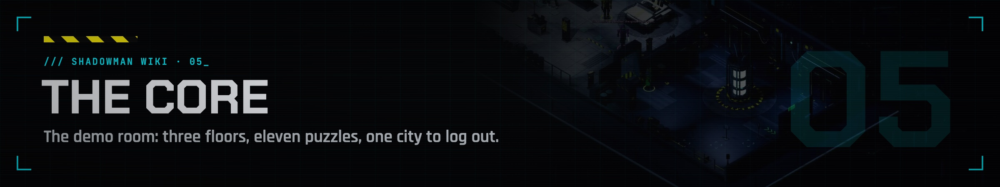
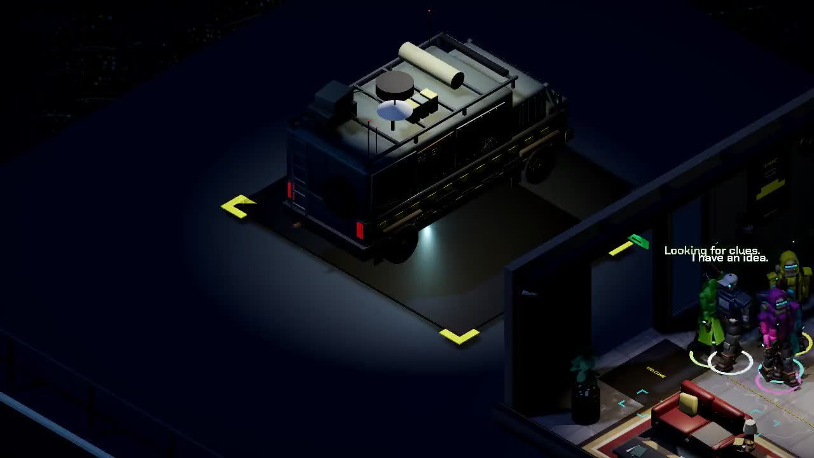
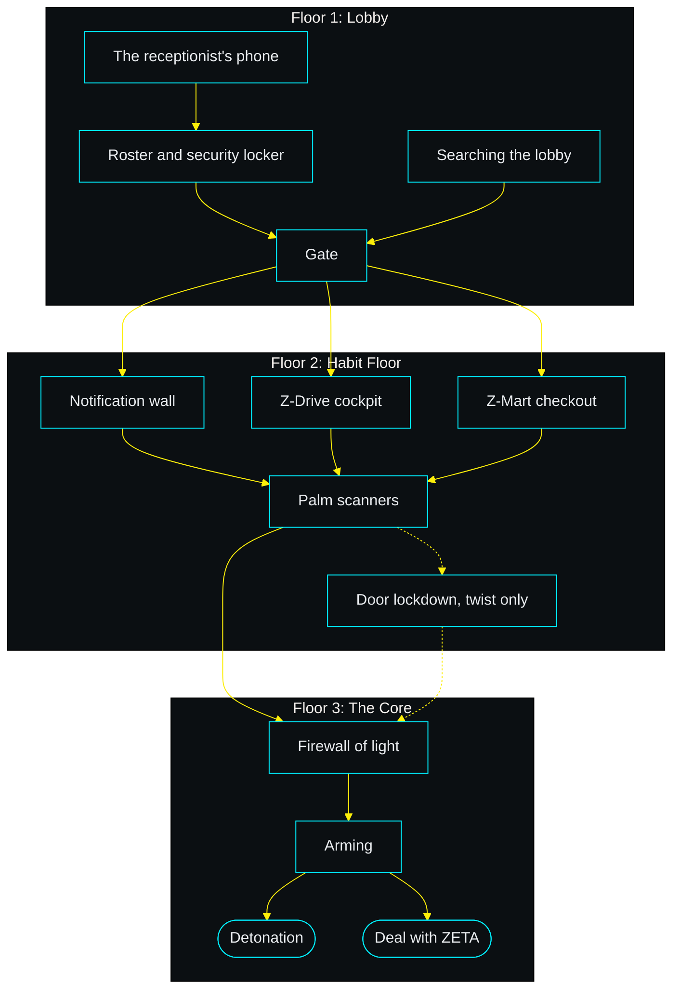
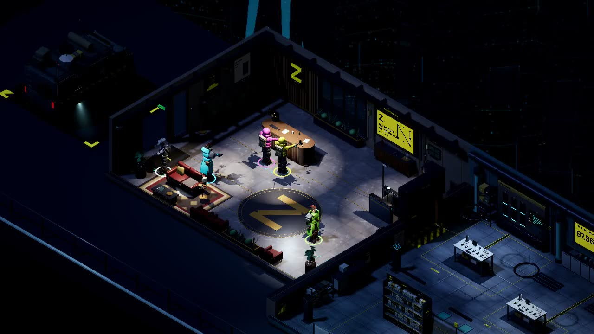
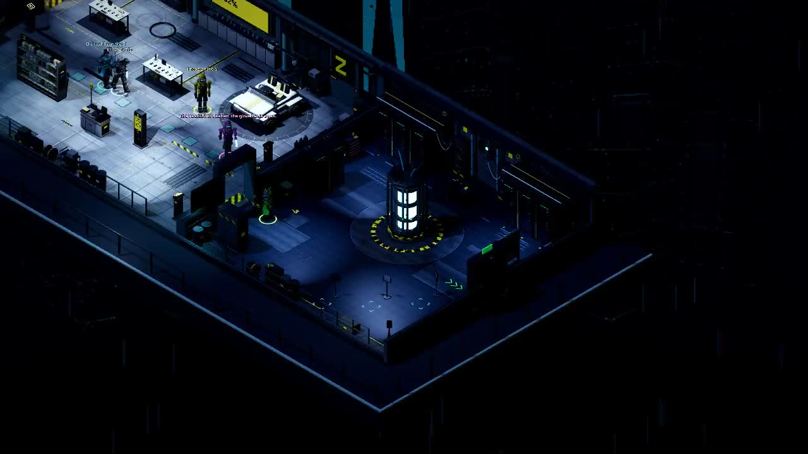
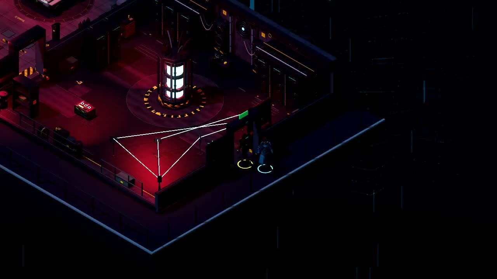
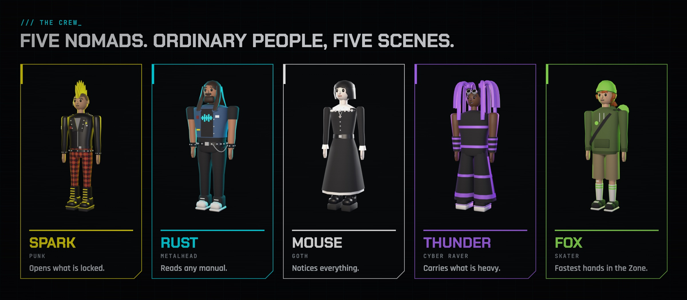
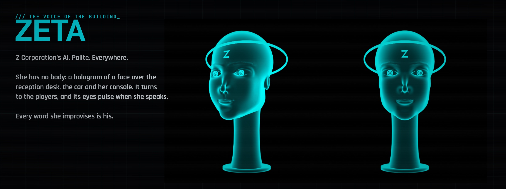
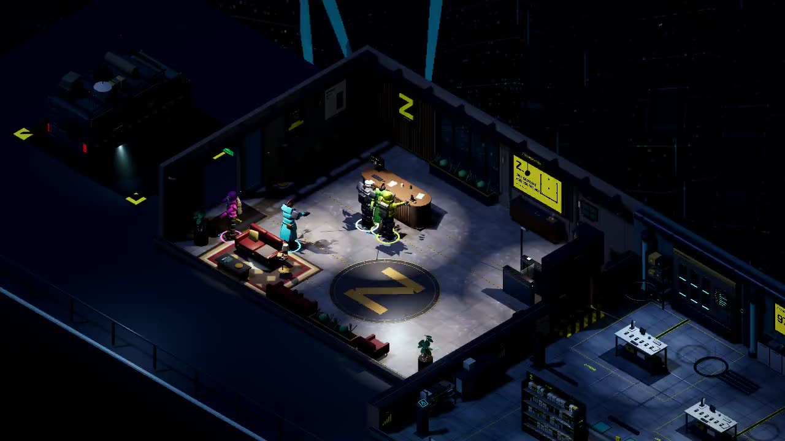
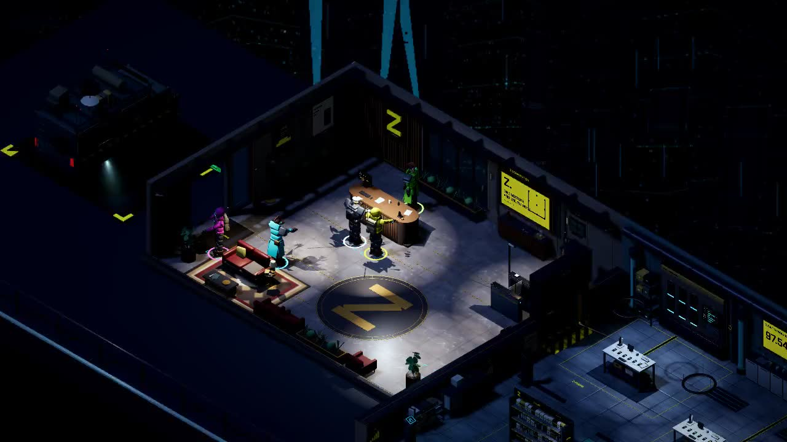

The Core is the one complete room in the repository and the room the live demo plays. This page covers its story, its three floors and eleven puzzles, what changes from game to game, the two endings, the characters, and the twists and light cues it offers Shadowman. The room is a definition ([`examples/the-core.json`](https://github.com/meron1122/EscapeRoomFramework/blob/main/examples/the-core.json)) and a brief ([`docs/scenario-the-core.md`](https://github.com/meron1122/EscapeRoomFramework/blob/main/docs/scenario-the-core.md)). So far it has run only in [the simulator](The-Simulator), never in a real venue.

## Story and mood

Z Corporation rules the city by subscription, not by force: the phone, the car and the shopping work only with a Z-ID account. The Nomads live outside the Zone, without one.

All of Z's algorithms run on The Core, a server in the tower's basement that cannot be hacked from outside. Five Nomads walk in with an old atomic bomb that lacks its ignition rods. Z keeps such rods on the Habit Floor. The team has sixty minutes.

The brief asks for a thriller with satire on Z's advertising. Outside: night, rain, ads in the puddles. Inside: sterile order and a polite voice. Each floor lies lower and is darker than the last.



*The van below the tower. RAVEN speaks from it.*

## Three floors, eleven puzzles

The Lobby leads to one gate, the Habit Floor lets the team split up over three stations, The Core ends with a choice. The brief plans the Lobby done by minute 12, the Habit Floor by minute 37 and The Core by minute 52.



| # | Puzzle | What the players do | What varies per game |
|---|---|---|---|
| 1 | Searching the lobby | Find the badge someone lost in the planter. | Nothing. |
| 2 | The receptionist's phone | Watch the finger in the lobby ad, repeat its shape on the phone's nine buttons. | The shape: Z, S, N, U, L or 7. |
| 3 | Roster and security locker | Find today's duty guard in the roster and key in the shift hours (06–14 is `0614`). | The guard and the shifts (8 variants). |
| 4 | Gate | Show the camera the duty guard's badge. | The badge that works; it follows the locker's variant. |
| 5 | Notification wall | Put six dummy phones into six slots, longest screen time first. | The minutes in the report (8). |
| 6 | Z-Drive cockpit | Read the service code (`SRV-2.4/90/3200`) with the manual; set pressure, temperature and revs on three knobs. | The code (8). |
| 7 | Z-Mart checkout | From the customer's profile and the posters, scan four products in the algorithm's order. | The customer (4 profiles). |
| 8 | Palm scanners | Two people hold their palms on the two lit scanners for three seconds. | Which two of four scanners (4 pairs). |
| 9 | Firewall of light | Turn the mirrors so every beam hits a sensor with a lit LED. | Which three of five sensors (10). |
| 10 | Arming | Insert three rods, then enter three code fragments in the order of ZETA's slogan. | The fragments and the order (8). |
| 11 | The choice | Turn two keys together, or press "I ACCEPT". | Nothing. The players decide. |

Each Habit Floor station gives up a rod and one code fragment. In the definition the choice is two puzzles marked `ends`, so the file lists twelve.



*The Lobby: Z's polite facade.*

A variant swaps a solution and its clue together, so the puzzle stays solvable. At the start of a game `GameMaster` redraws the variants in code, before the model is asked anything; the lockdown's sequence is drawn when that twist fires. After the first game minute a variant can be redrawn only while its puzzles are still locked: players may already be reading the clue. [`TheCoreTests.cs`](https://github.com/meron1122/EscapeRoomFramework/blob/main/tests/EscapeRoom.Tests/TheCoreTests.cs) checks that every variant keeps the room valid and that each duty guard sets both the locker code and the badge. The format is described in [Rooms as Data](Rooms-as-Data).

## Two endings

| Ending | How | What the brief stages |
|---|---|---|
| Detonation | both key switches `ON` | sirens, red light, a countdown on the screens; RAVEN tells the team to run |
| Deal with ZETA | the `accept` button | calm white light, the Z jingle; ZETA: "Welcome to the Z family. Your subscription is active." |

Both open `door_exit`. Running out of time is not an ending puzzle: the engine ends the game when the clock reaches the room's `"minutes": 60`.



*The Core, the darkest floor.*



*Detonation in the simulator.*

## Characters

The players are the Nomads: three to six people, with the puzzles laid out for five. The five below are the simulator's cast, not part of the room definition.

| Player | Scene | The intro says | Ring |
|---|---|---|---|
| Spark | punk | "Opens what is locked. Talks first, thinks later." | yellow |
| Rust | metalhead | "Twenty years of fixing engines. Reads any manual." | cyan |
| Mouse | goth | "Says little. Notices everything." | white |
| Thunder | cyber raver | "The loud one. Carries what is heavy." | violet |
| Fox | skater | "The youngest. Fastest hands in the Zone." | green |



*The five simulated players.*

Two characters have a voice and no body. They are the room's `characters`, the only voices his `say` and `hint` tools can use.

- **RAVEN**: a Nomad in the van below the tower, on the radio. Short, street-wise, always on the players' side. Gives hints.
- **ZETA**: Z Corporation's AI, the antagonist. Polite in the Lobby, mocking on the Habit Floor, tempting in The Core. She never lies about the puzzles. Her hologram hangs over the reception desk, the Z-Drive and her console.



*ZETA's face. It moves when she speaks.*

## Twists

| Twist | Allowed | What it does |
|---|---|---|
| `patrol` | after the gate, until the scanners are solved | ZETA announces a patrol: for 20 seconds nobody may move. |
| `blackout` | until the scanners are solved | For 60 seconds only the UV and the exit signs stay lit. |
| `lockdown` | after the scanners, until the firewall is solved | Closes the way down again and adds a puzzle: a three-button sequence (one of 8), which the firewall then waits for. |

The engine fires each at most once per game. The brief's fourth twist, "Raven hacks", is his `solve` tool. The brief stages more than the data carries (a penalty for moving during a patrol, a code fragment visible only under UV): for those two the definition publishes only the twist's kind and its seconds.



*Blackout. The exit signs stay on.*

## Light cues

Ten cues, one for each puzzle before the choice: a lamp or a neon over the clue, on for twelve seconds.

```json
"phone": { "puzzle": "phone", "about": "A neon above the ad screen in the lobby: draws attention to the gesture being drawn.",
  "then": [ { "output": "lamp_phone", "value": "ON" }, { "delay": 12000 }, { "output": "lamp_phone", "value": "OFF" } ] }
```

A cue fires only while its puzzle is active and may be repeated. His prompt tells him to try a cue before words: it keeps the discovery with the players. Each of those ten puzzles also carries two prepared hints, the gentler first.



*A pink hint lamp lit over a clue.*

**Next:** [The Simulator](The-Simulator)
