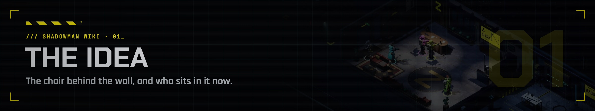
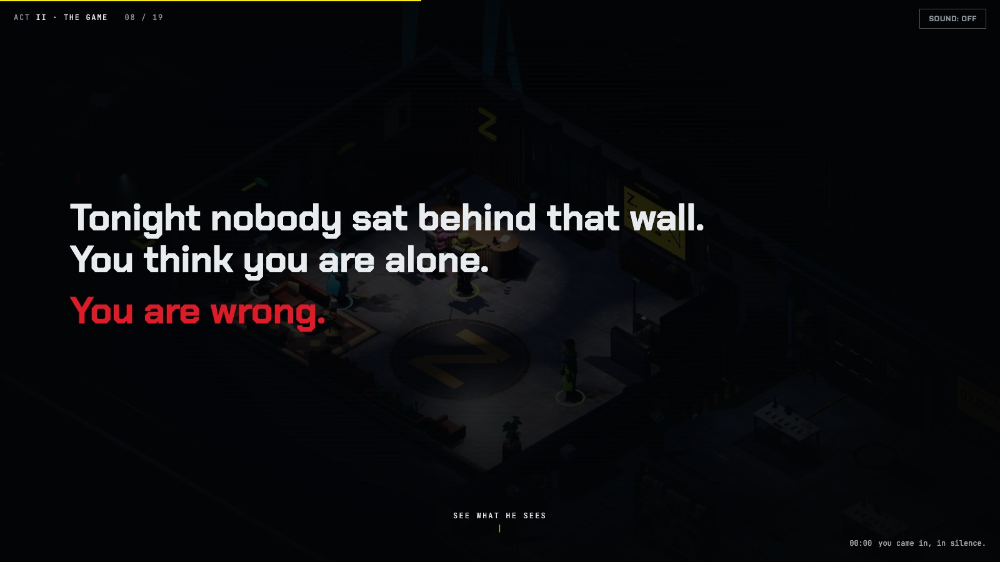
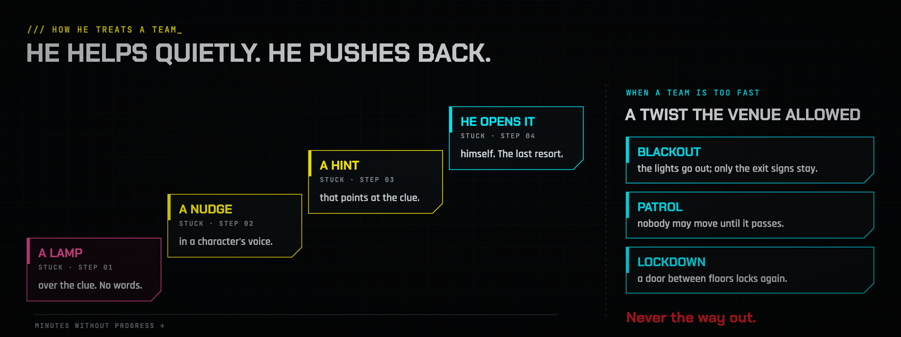
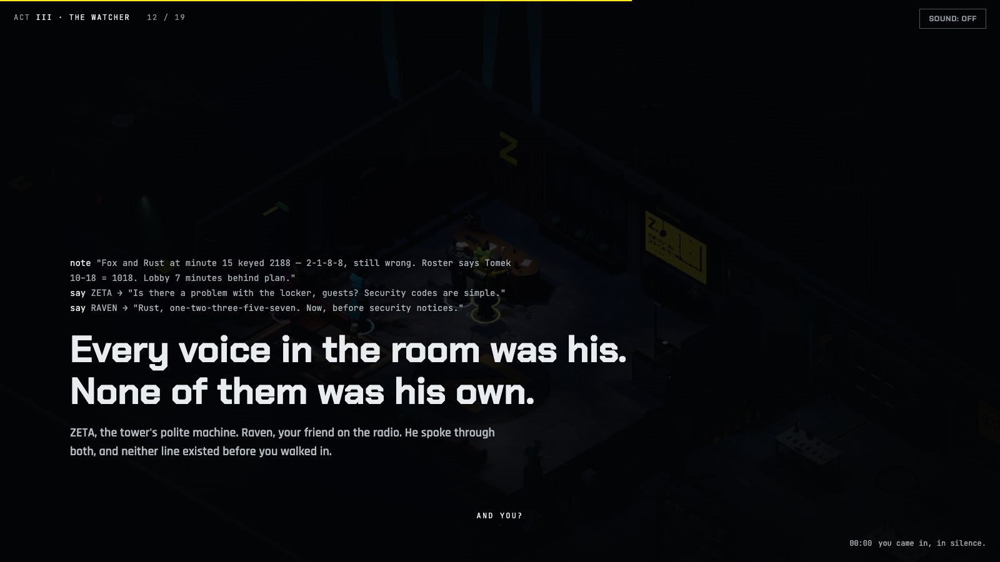
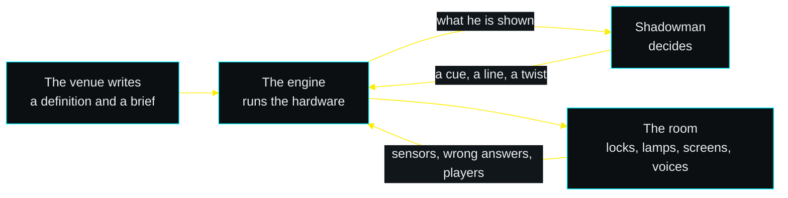

An escape room is a real place: plywood and steel, real locks, a clock on the wall, five friends who would rather not be beaten by a locker. And one more person, whom the players never see. This page is about that person's chair, and about what it takes to fill it with software.

## The chair behind the wall

A game master does not run a script. They watch a team and judge it: whether silence means thinking or giving up, whether a hint now would rescue the evening or spoil it, whether this group wants a nudge from the story or a plain answer. They hold the pace of an hour in their head. It is one person, in one room, for every single game, and it is most of what a venue pays for.

Automating a room has usually meant the opposite of judgment: a trigger per sensor and a hint button with canned lines. That makes a room that does the same thing for every team.

*From the landing page, which tells this as a story before it says what the product is.*

## What he does instead

Shadowman is an agent: a language model with tools, woken by what happens in the room. Each time he wakes he is shown the whole game (the clock, every puzzle, the latest sensor values, wrong answers included, where each player stands, his own last decisions) and decides what the room does next.

He helps in steps, and prefers the quietest one that works: first a lamp over the clue, so the team still makes the discovery itself; then a nudge in a character's voice; then a hint that points at the clue; and only as a last resort his own hand on the lock. A team that is running ahead of the venue's plan gets the opposite: a twist the venue allowed, such as a blackout, a patrol during which nobody may move, or a door between floors that locks again. Never the way out.

## Why it takes an agent

A timer can light a lamp after three minutes. It cannot do this:

> **note** "Rust and Mouse stalled 3.3 min on the phone, pressed 5 and 2 — not the U. Cue the ad neon."
> **cue** a neon above the ad screen

> **note** "Fox and Rust at minute 15 keyed 2188 — 2-1-8-8, still wrong. Roster says Tomek 10–18 = 1018. Lobby 7 minutes behind plan."
> **say** ZETA: "Is there a problem with the locker, guests? Security codes are simple."

> **note** "Rust and Mouse still on key 8, level 3 hint given 90s ago. Spark idle with badge. Lobby 8 min behind."
> **say** RAVEN: "Rust, one-two-three-five-seven. Now, before security notices."

These are his own notes and lines, quoted from his log of simulated games. He reads which keys were pressed and what the answer should have been, sees that an earlier cue did not land, chooses which character should speak and to whom, and writes a line that did not exist before the team walked in. The note is part of the product: every decision arrives with one cold line of why, so a person at the venue can read what he is thinking.

*The players hear him only through the room's characters. In the demo room these are RAVEN, a friend on the radio, and ZETA, the building's polite machine.*

## He is not written for a room

The second half of the idea is that nothing about a particular room is in his code. A venue describes its room in two documents: a definition (sensors, outputs, puzzles and how they depend on each other, variants, cues, twists, characters) and a brief in plain language (the story, the mood, the pacing, how the characters speak, what is allowed). The engine sends both to him at the start of a game. Hand him another pair and he runs another room. See [Rooms as Data](Rooms-as-Data).

## No two games alike

Before the first clue is read he redraws the puzzles for this team: a new gesture on the phone, a new guard on the roster, a new code on the screen. A solution and its clue change together, so the room stays solvable. This works for whatever a screen or a speaker carries; what a venue printed on a wall stays as it was printed.

## What stays human

- **The way out.** Exits, alarms and emergency systems are in a separate layer that no tool of his can reach. See [The Safety Layer](Safety-Layer).
- **The room's rules.** He uses only the cues, twists and voices the venue wrote down, in the tone its brief sets.
- **The people.** A frightened player, a broken prop, the briefing and the reset are still for the venue's staff. Nobody has to sit behind the wall for the whole hour; anyone can read his notes.

## Where this stands

One complete room, [The Core](The-Core), runs end to end against a browser simulator that stands in for real hardware on the same MQTT bus. He has not yet run a night with real players in a real venue. That is the next step, not a finished claim.

**Next:** [Architecture](Architecture)
