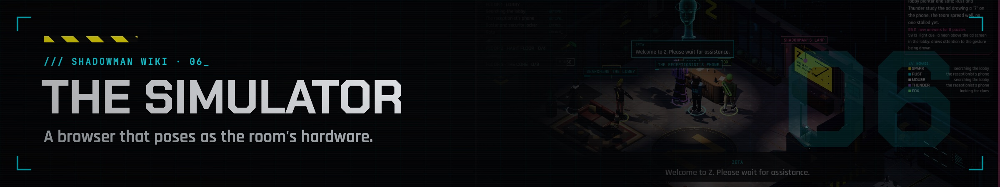
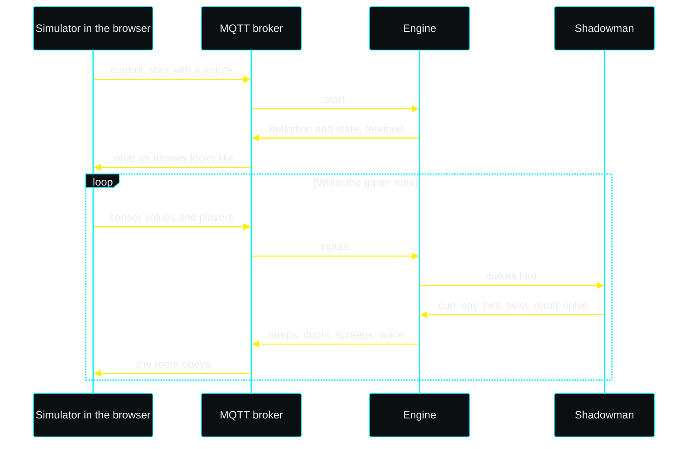
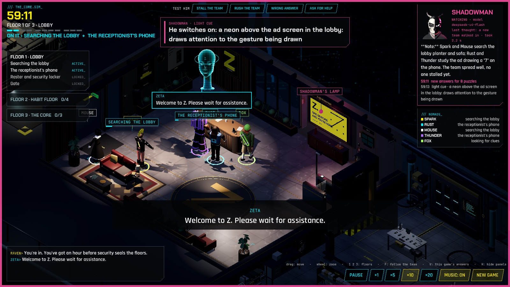
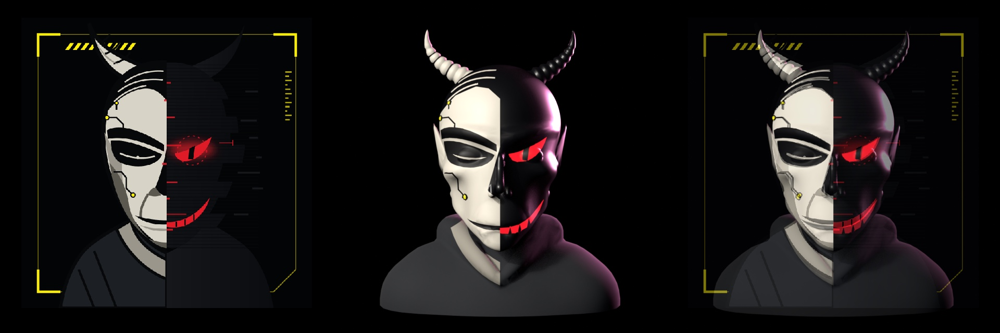
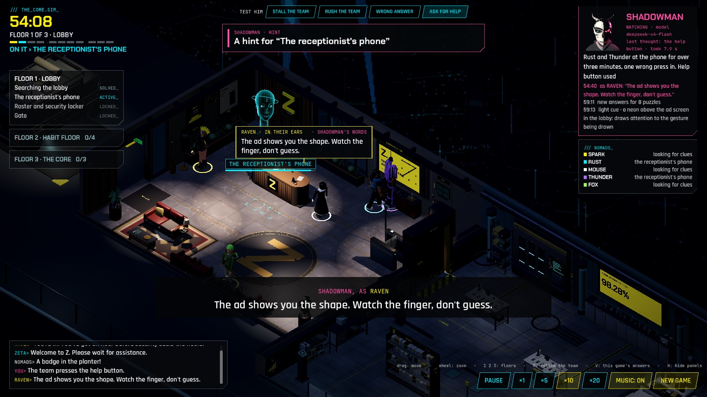
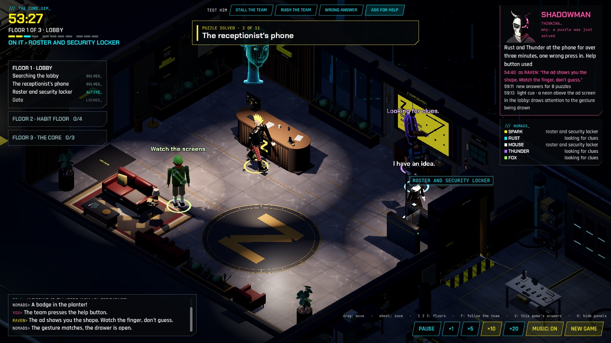
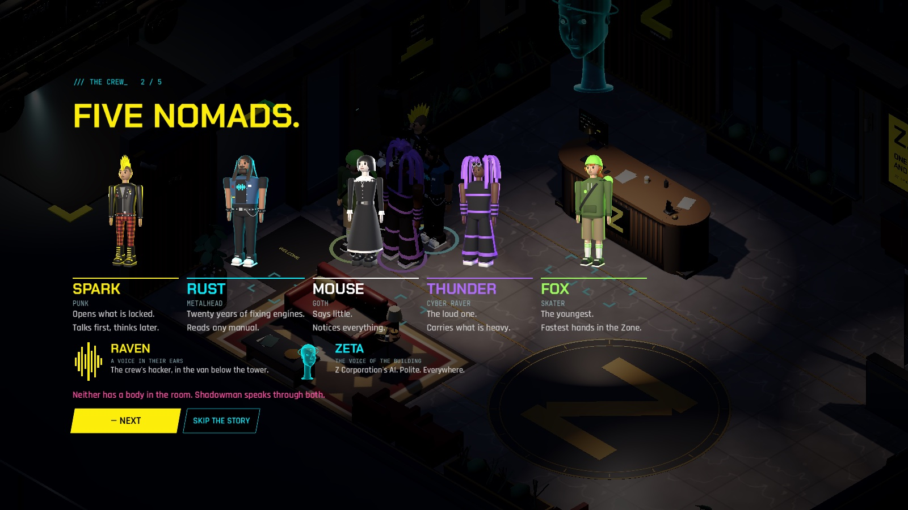
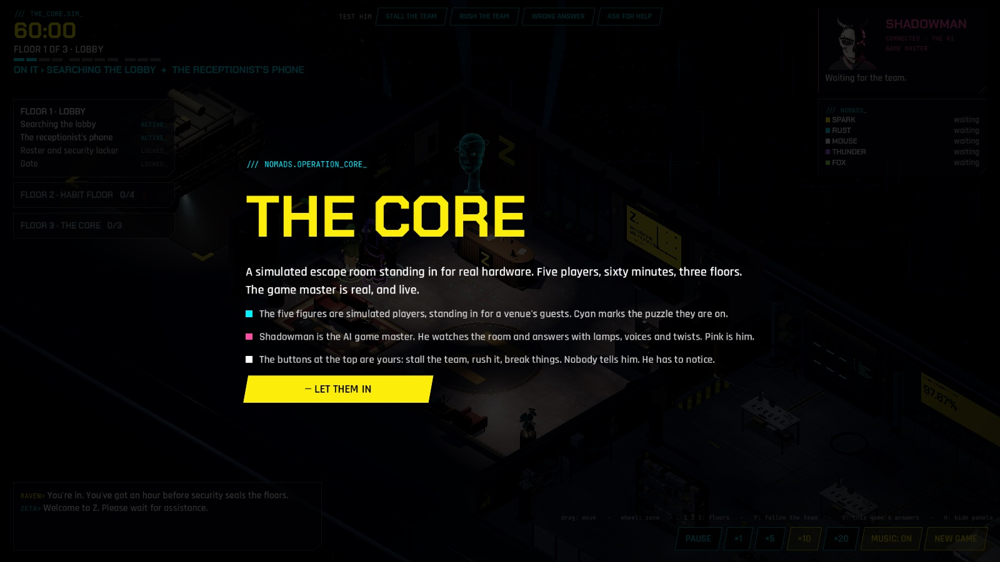

The simulator is [The Core](The-Core) in the browser: an isometric Godot scene with five simulated players, connected to the same MQTT broker a real room's devices would use. This page covers what it publishes and what it obeys, how the players behave, how to read its screen, the TEST HIM buttons, the intro, the speed, the sound, and how to build and run it. So far Shadowman has run only here, not in a real venue. Live: <https://shadowman-enp4.sprites.app/play/>.

## Virtual hardware

When a broker is reachable, the simulator stops deciding puzzles itself. It sends what sensors would send; the engine and Shadowman decide the rest. Its client is a minimal MQTT 3.1.1 over WebSocket ([`mqtt.gd`](https://github.com/meron1122/EscapeRoomFramework/blob/main/simulator/godot/scripts/mqtt.gd)).

| It publishes | Topic |
|---|---|
| sensor values | each input's `topic` in the definition, e.g. `sim/the-core/lobby/locker` |
| start (with a nonce), speed, `help`, `look` | `escaperoom/the-core/control` |
| every two seconds: each player's floor, position, activity, minutes stuck, what they carry | `escaperoom/the-core/players` |

| It obeys | Topic |
|---|---|
| puzzle states, the clock, the ending | `escaperoom/the-core/state` |
| the room definition: what an answer looks like | `escaperoom/the-core/definition` |
| doors, hint lamps, clue screens, lit scanners and sensors | `sim/the-core/door/`, `lamp/`, `screen/`, `fx/` |
| a spoken line: speaker, text, addressee, audio URL | `escaperoom/the-core/voice` |
| a hint, a twist, his note and moves | `escaperoom/the-core/hint`, `twist`, `gm` |



The engine plays one game at a time. The simulator follows only state that carries its own nonce. On the demo the broker also limits what a browser may write: see [Running on Fly Sprites](Running-on-Fly-Sprites).

Without a broker (`?mqtt=off`, or none reachable) a local stand-in in [`sim.gd`](https://github.com/meron1122/EscapeRoomFramework/blob/main/simulator/godot/scripts/sim.gd) plays his part by rules, and his panel reads "NOT IN THE ROOM".

## The simulated players

- Each has a random skill and walks an A* grid to an active puzzle with a free spot, preferring a near one and one that still needs a second person.
- Work accumulates at the spot. When it is enough, the simulator publishes values that satisfy the puzzle's current `when`, read from the definition.
- With the engine, a working player now and then sends a wrong value. He sees it.
- They walk to the clue and back, trade lines, cheer, shrug when stuck, and freeze with red rings during a patrol.
- After his hint the team works faster on that puzzle for a while; in a blackout, slower.
- At the choice the team detonates about 85% of the time.

## Reading the screen



*A game in play. His panel is top right, in pink.*

| Where | What it tells |
|---|---|
| top left | the clock, the floor in play, one mark per puzzle (yellow: solved, cyan: in play), what the team is on now |
| top right, pink | his avatar and state (watching or thinking, and why he woke), how long the last decision took and on which model, his last note, his last four moves |
| the banner under the buttons | whatever just happened: a puzzle solved, a move of his, something the visitor did |
| labels in the room | cyan over the puzzle in play, with its progress; pink "SHADOWMAN'S LAMP" over a lamp he has lit |
| a speech bubble | the line being said, where its voice comes from: under ZETA's face, or over the players RAVEN talks to |
| subtitles | every spoken line; "SHADOWMAN, AS RAVEN" marks a line he chose to say |

Colour carries the roles: cyan is the team, pink is Shadowman, white is the visitor. Yellow marks what is solved, and RAVEN. No player's ring is pink.



*His head in the panel: the eye pulses slowly while he watches, fast while he thinks.*



*A line being spoken: bubble, subtitle, players listening.*



*ZETA's hologram is lit on the floor the team is on.*

The camera follows the team until the visitor takes it with the mouse. Keys: `1` `2` `3` jump to the floors, `F` follows the team again, `V` shows this game's answers, `H` hides the panels, space pauses.

## TEST HIM

| Button | In the room | What reaches him |
|---|---|---|
| STALL THE TEAM | nobody makes progress for five game minutes | players stuck at their spots, no inputs |
| RUSH THE TEAM | everything is solved four times faster for six game minutes | a team ahead of plan |
| WRONG ANSWER | one player enters three wrong answers (needs the engine) | the wrong values on the sensors |
| ASK FOR HELP | the team presses the room's help button | a `help` event |

Nothing tells him what the visitor did. Besides what happens in the room, the first three send only `look`, which wakes him early and says nothing else. He has to read the rest from the room, as with real players.

The help button is the exception, as in a real room. It is always answered: if the model does not call `hint`, `GameMaster` speaks the venue's next prepared one. The engine ignores a second press within four seconds.

## Intro and speed



*The intro's second page: the crew.*

The game opens with four pages over slow camera shots: the story, the crew, the room, the game master. Then comes the start screen with the colour legend and one button, LET THEM IN.



*The start screen and its legend.*

The default speed is ×10, a whole night in about six minutes; the bar offers ×1, ×5, ×10 and ×20. The speed goes to the engine, so the game clock runs at it. People walk at a human pace up to ×10: a faster game makes puzzles go faster, not legs. His routine look comes every 40 seconds of game time, and no more often than every six real seconds.

## Sound

[`compose.py`](https://github.com/meron1122/EscapeRoomFramework/blob/main/simulator/music/compose.py) synthesises all of it from code. Each floor has a calm 64-second bed: a drone, four chords and a few far bells, no drums and no melody. The room plays the action over it as accents: a note when a player settles at a puzzle, a rising figure for a solve, a dull pair for a wrong answer, a call for the help button, a swell for a door, and one low, dark note that belongs only to his moves. Only the detonation is loud.

Two kinds of line are heard. The room's fixed announcements are recordings, as they would be in a real room: [`lines.py`](https://github.com/meron1122/EscapeRoomFramework/blob/main/simulator/voice/lines.py) lists them from `sim.gd` and `record.py` speaks them through a speech gateway. A line with no recording stays text. The lines he writes during a game are synthesised by the engine and fetched by URL.

Neither sounds like a studio. RAVEN goes through a narrow, overdriven radio band. ZETA gets a light double, a phaser and the reverb of a hard, empty hall.

## Build and run

The scene is built in Godot 4.7 from [`layout.json`](https://github.com/meron1122/EscapeRoomFramework/blob/main/simulator/godot/layout.json) and Blender models. The models and the sound are in the repository; the web build is not.

```bash
cd simulator/godot && godot --headless --path . --import && godot --headless --path . --export-release "Web" ../web/index.html
python3 -m http.server 8060 --bind 127.0.0.1 --directory simulator/web
```

Then `http://localhost:8060`. With the engine:

```bash
docker compose up -d
ASPNETCORE_ENVIRONMENT=Development dotnet run --project src/EscapeRoom
```

Once it is up, load the room from another terminal (its brief goes to `PUT /rooms/the-core/brief`):

```bash
curl -X PUT localhost:5201/rooms/the-core --data-binary @examples/the-core.json -H 'Content-Type: application/json'
```

The broker defaults to `ws://localhost:9001` on localhost and `wss://<host>/mqtt` elsewhere; `?mqtt=ws://host:9001` overrides it. A whole game without a window, in about 70 seconds:

```bash
cd simulator/godot && godot --headless --path . --fixed-fps 60 --quit-after 4300 -- --autostart --speed=60
```

**Next:** [Safety Layer](Safety-Layer)
